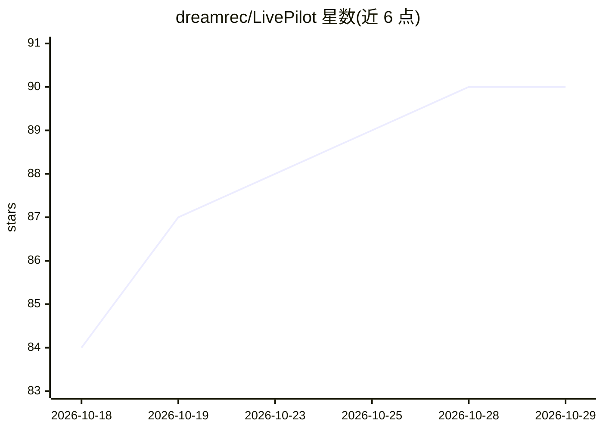

# dreamrec/LivePilot

⭐ 90 · Python · NOASSERTION · 推送 2026-10-22 · [GitHub](https://github.com/dreamrec/LivePilot) · [官网](https://github.com/dreamrec/LivePilot) · 组织维护

**把 AI 客户端接入 Ableton Live 12 的 MCP 服务器（474 个工具/57 个领域）**

面向音乐制作人的 MCP 服务器：通过运行在 Ableton 进程内的 Python Remote Script（TCP 9878）、可选的 Max for Live 桥（OSC/UDP）与 FastMCP 服务器，让 Claude Code、Claude Desktop、Cursor、Codex、VS Code、Windsurf 等 MCP 客户端直接操控 Live 的轨道、片段、设备、混音与自动化。内置 5,264 设备图谱、三源样本搜索引擎（含本地 Splice 目录）、自然语言到计划的 Composer 流水线、44 个语义动作及 12 个规划/评估系统（SongBrain、Taste Graph、Wonder Mode 等）。集内改动走 Ableton undo 栈，下载与安装器改动不可撤销。仅支持 Ableton Live 12+，macOS 与 Windows。

## 筛选速览

| 维度 | 判定 | 备注 |
|---|---|---|
| AI 角色 | `ai-ecosystem` | LLM/agent 周边工具 |
| 许可风险 | `none` | NOASSERTION |
| 部署形态 | `desktop` | 安装包/桌面程序 |
| 模型依赖 | locked-api |  |
| 硬件要求 | — | 无带数字的原话,不猜 |
| 安装摩擦 | `low` | 无编译、无系统依赖或容器化 |
| 成熟度 | `idea` | |

## 能力要点

- 474 个工具、57 个领域，覆盖轨道/片段/设备/混音/自动化与 Arrangement View 控制
- 5,264 设备图谱（120 个含 YAML 声音档案）与三源样本搜索（Ableton 库/本地 Splice SQLite/文件系统）
- Composer 将自然语言解析为 CompositionIntent 并生成工具调用计划（不自主执行）
- SongBrain/Taste Graph/Wonder Mode 等 12 个规划与评估系统，集内改动走 Ableton undo 栈

## 适用场景

- 用对话方式在 Ableton Live 12 中搭轨道、改混音、做编曲
- 编辑前后对比音频频谱，保留有效版本
- 卡壳时用 Wonder Mode 生成多个变体预览再决定
- 让 AI 客户端搜索设备库与本地 Splice 样本再加载

## 场景标签

 · 领域:音乐制作/DAW 工具

## 证据(README 行号)

> L22: > LivePilot works with any MCP client, including Claude Code, Claude Desktop, Codex,
> L124: **MCP Server** (`mcp_server/`) — Python FastMCP server. Validates inputs, routes commands to the Remote Script ove
> L17:  LivePilot connects an AI client to Ableton Live 12. Sketch ideas, edit the set,

## 星数曲线

2026-10-18 84 → 2026-10-29 90（+6）

---
*卡片 v1 · prompt 1.4 · 生成 2026-10-24 · 置信度 mid · 依据 README sha `2b91b912627a` · [字段定义](../../DATASET.md)*
