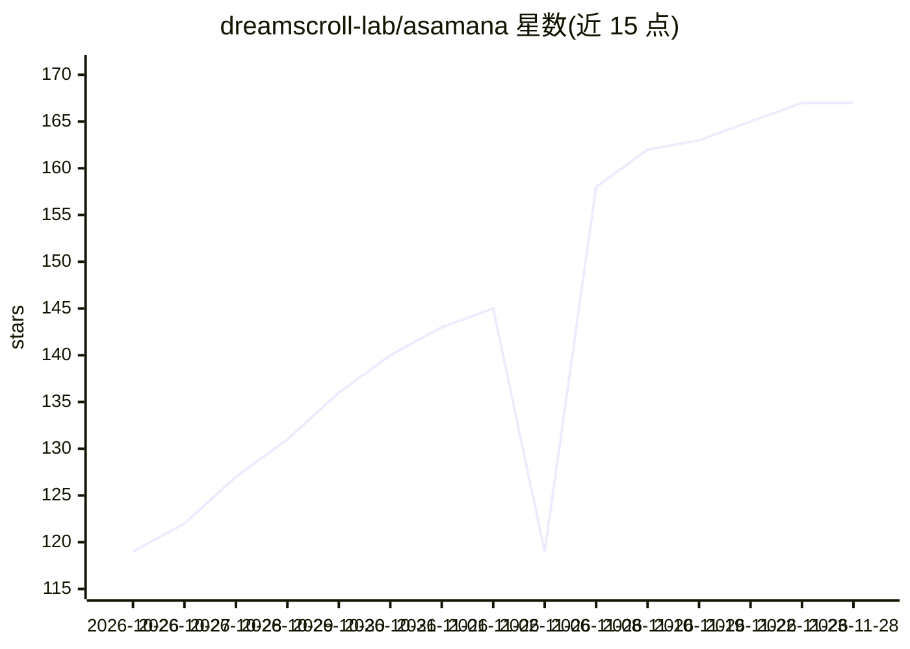

# dreamscroll-lab/asamana

⭐ 167 · Python · Apache-2.0 · 推送 2026-11-21 · [GitHub](https://github.com/dreamscroll-lab/asamana) · 组织维护 · 中文 README

**AI 驱动的涌现叙事引擎：LLM 角色自主互动生成故事**

给一个主题即可生成含多个 AI 角色的共享世界，角色具备人格、价值观、情绪、需求、关系与记忆，无预设剧本，故事从角色互动中涌现。架构上后端 Python 单进程提供 REST API 与 WebSocket，认知循环以五阶段流水线（感知→动机→决策→行动→反馈）编排，阶段间用类型化 JSON 传递以限制幻觉扩散；前端 React+Phaser 提供观察、回放与 2D 地图。任何 OpenAI 兼容端点开箱可用，不同场景可路由不同模型。处于早期开发阶段，API 与存档格式不保证向后兼容；提示词与生成叙事目前为中文。

## 筛选速览

| 维度 | 判定 | 备注 |
|---|---|---|
| AI 角色 | `ai-native` | 本体是模型或模型工具 |
| 许可风险 | `permissive` | Apache-2.0 |
| 部署形态 | `self-host` | docker 或自建部署 |
| 模型依赖 | — | README 未给出锁定关系 |
| 硬件要求 | — | 无带数字的原话,不猜 |
| 安装摩擦 | `low` | 无编译、无系统依赖或容器化 |
| 成熟度 | `idea` | |

## 能力要点

- 五阶段认知流水线：分阶段编排 LLM 调用，类型化 JSON 契约传递
- 角色具备人格、情绪、需求、双重记忆流（FACTUAL/EXPERIENTIAL）与反思机制
- 导演/演员两种模式：全局观察可介入，或扮演单个角色从内部探索
- 任何 OpenAI 兼容端点开箱可用，按场景路由不同模型

## 适用场景

- 输入一个主题生成多角色涌现式互动故事并旁观推进
- 扮演世界中任意角色，从内部探索和影响剧情
- 研究 LLM 生成式 agent 的认知循环与记忆/反思机制
- 复用内置玄武门之变等示例世界做离线浏览与回放

## 场景标签

`多智能体` · 领域:Agent 开发

## 证据(README 行号)

> L12: **Asamana is an AI-driven emergent narrative engine.**
> L14: Give Asamana a theme, and it creates a shared world with a cast of AI characters, each with a distinct persona and 
> L54: - **LLM access**: any OpenAI-compatible endpoint works out of the box, with no code changes, and different scenes c

## 星数曲线

2026-10-26 119 → 2026-11-28 167（+48）

---
*卡片 v1 · prompt 1.4 · 生成 2026-11-27 · 置信度 high · 依据 README sha `3358531bfb0c` · [字段定义](../../DATASET.md)*
