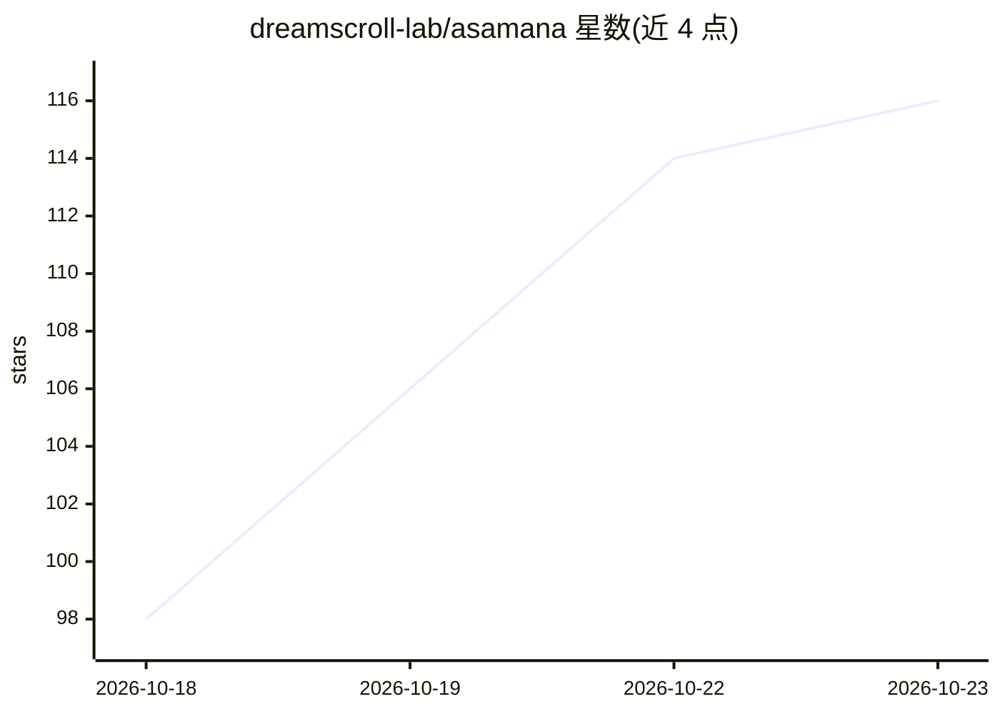

# dreamscroll-lab/asamana

⭐ 116 · Python · Apache-2.0 · 推送 2026-10-08 · [GitHub](https://github.com/dreamscroll-lab/asamana) · 组织维护 · 中文 README

**AI 驱动的涌现式叙事引擎：给定主题即生成多角色自主互动世界**

给 Asamana 一个主题，它生成含多个 AI 角色的共享世界：每个角色具有性格、记忆、情绪、需求与目标，故事由角色自主互动涌现，无预设剧本。认知循环以五阶段流水线（感知→动机→决策→行动→反馈）编排，阶段间用类型化 JSON 契约交换数据。后端 Python 提供 REST API 与 WebSocket，前端 React+Phaser 提供地图与观演界面；任意 OpenAI 兼容端点即可接入，Docker Compose 一条命令启动。当前早期开发阶段，提示词与生成叙事均为中文，无 key 时仅可浏览回放示例世界。

## 筛选速览

| 维度 | 判定 | 备注 |
|---|---|---|
| AI 角色 | `ai-native` | 本体是模型或模型工具 |
| 许可风险 | `permissive` | Apache-2.0 |
| 部署形态 | `self-host` | docker 或自建部署 |
| 模型依赖 | locked-api |  |
| 硬件要求 | — | 无带数字的原话,不猜 |
| 安装摩擦 | `low` | 无编译、无系统依赖或容器化 |
| 成熟度 | `idea` | |

## 能力要点

- 五阶段认知流水线编排，阶段间类型化 JSON 契约
- 角色具备记忆、情绪、需求与关系，故事无预设剧本涌现
- 任意 OpenAI 兼容端点可用，不同场景可路由不同模型
- 无 key 也能浏览与回放两个示例世界（玄武门之变等）

## 适用场景

- 输入一个主题，观察多 AI 角色自主演化出故事
- 回放与审计已生成世界的叙事与每个角色的认知过程
- 开发者用追踪与审计工具调优提示词和模型配置

## 场景标签

`多智能体` `Agent 框架` · 领域:Agent 开发

## 证据(README 行号)

> L11: **Asamana is an AI-driven emergent narrative engine.**
> L13: Give Asamana a theme, and it creates a shared world with a cast of AI characters, each with a distinct persona and 
> L137: Every character, line of dialogue and plot point in a world is generated live by the LLM you connect. It doesn't r

## 星数曲线

2026-10-18 98 → 2026-10-23 116（+18）

---
*卡片 v1 · prompt 1.4 · 生成 2026-10-23 · 置信度 high · 依据 README sha `7c2eeb1440eb` · [字段定义](../../DATASET.md)*
