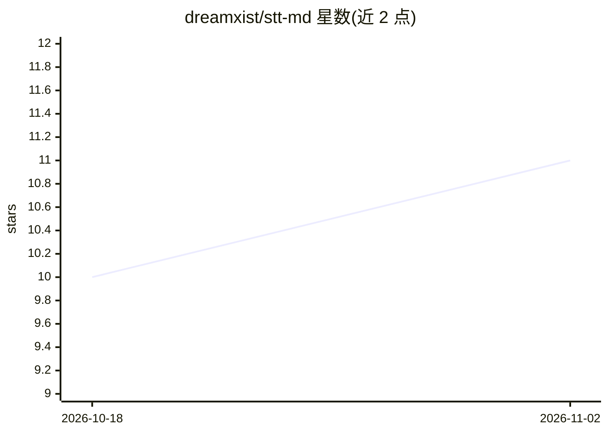

# dreamxist/stt-md

⭐ 11 · Rust · MIT · 推送 2026-10-21 · [GitHub](https://github.com/dreamxist/stt-md) · 个人维护

**本地录音转写并生成 Markdown 会议笔记的 macOS 菜单栏应用**

约 3 MB 的 Rust 原生 macOS 菜单栏应用：录音后经本地 Whisper.cpp（Metal 加速）批量转写，再调用本地 Ollama 生成结构化 JSON 摘要，输出为 Markdown 文件。提供 simple 与 obsidian 两种输出模式；obsidian 模式扫描 vault 既有标签与 wikilink 构成封闭词表注入提示词，并在事后过滤幻觉标签。要求 macOS 11+ Apple Silicon、本地运行 Ollama、Whisper GGML 模型，从源码构建需 Rust 1.85+。限制包括批量处理而非流式、无代码签名、界面与提示模板为西班牙语。

## 筛选速览

| 维度 | 判定 | 备注 |
|---|---|---|
| AI 角色 | `ai-native` | 本体是模型或模型工具 |
| 许可风险 | `permissive` | MIT |
| 部署形态 | `None` |  |
| 模型依赖 | local-ok | 支持本地模型 |
| 硬件要求 | — | 无带数字的原话,不猜 |
| 安装摩擦 | `medium` | 含编译或系统依赖之一 |
| 成熟度 | — | 结构信号不足 |

## 能力要点

- 本地 Whisper + Ollama 全离线转写与摘要，音频不出本机
- 扫描 vault 既有标签作封闭词表并事后过滤幻觉标签/wikilink
- obsidian 模式写入会议笔记并在日记追加 Agent Log
- 会议应用占用麦克风时发送提醒通知（CoreAudio 检测，macOS 14+）

## 适用场景

- 会议结束后自动生成带标签的 Markdown 笔记存入 Obsidian
- 在不上云的前提下完成语音转文字与摘要
- 用任何 Markdown 编辑器（VS Code/Bear 等）管理 simple 模式输出

## 场景标签

`语音识别` `知识库管理` `AI 写作` · 领域:内容生成

## 证据(README 行号)

> L5: A 3 MB macOS menubar app that turns your meetings into structured Markdown notes — using local Whisper for speech-to
> L28:     B -->|click Stop| C[🧠 Whisper.cpp Metal GPU]

## 星数曲线

2026-10-18 10 → 2026-11-02 11（+1）

---
*卡片 v1 · prompt 1.4 · 生成 2026-11-02 · 置信度 high · 依据 README sha `eb1afb0b0e37` · [字段定义](../../DATASET.md)*
