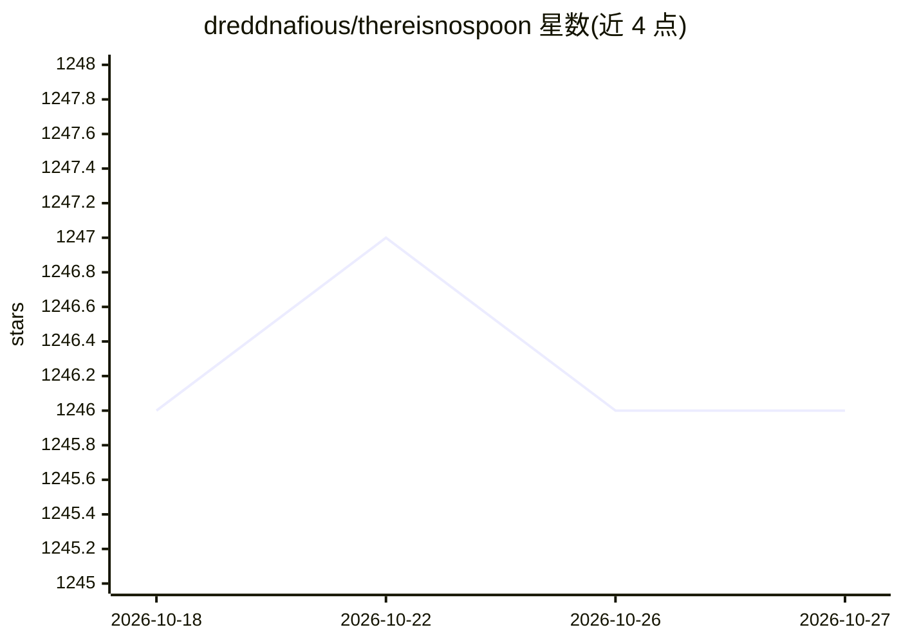

# dreddnafious/thereisnospoon

⭐ 1,246 · Python · MIT · 推送 2026-03-29 · [GitHub](https://github.com/dreddnafious/thereisnospoon) · 个人维护

**面向工程师的机器学习第一性原理入门读物**

单一 Markdown 文件构成的机器学习心智模型入门读物，目标读者是已有软件工程经验但缺乏 ML 直觉的工程师。内容分三部分：基础（神经元、组合、反向传播、泛化、表示）、架构（卷积/注意力/循环/图/SSM 组合规则、Transformer 详解、训练框架）、门控与控制系统；以物理与工程类比作为主要解释方式，数学为辅。支持独自阅读，或将文档喂给 AI 编程助手做对话式探索（作者记录其通过与 Claude 的对话构建而成）。12 张插图由 scripts/ 目录下的 Python 脚本生成，需 matplotlib 与 numpy。

## 筛选速览

| 维度 | 判定 | 备注 |
|---|---|---|
| AI 角色 | `ai-knowledge` | 知识聚合/清单类 |
| 许可风险 | `permissive` | MIT |
| 部署形态 | `None` |  |
| 模型依赖 | — | README 未给出锁定关系 |
| 硬件要求 | — | 无带数字的原话,不猜 |
| 安装摩擦 | `low` | 无编译、无系统依赖或容器化 |
| 成熟度 | — | 结构信号不足 |

## 能力要点

- 单一 Markdown 文件覆盖基础/架构/门控三部分
- 以物理与工程类比（偏振滤光片、折纸、齿轮系等）作为主要解释手段
- 提供与 AI agent 对话式学习的使用方式与提示词模板
- 12 张插图可由 scripts/ 下 Python 脚本重新生成

## 适用场景

- 软件工程师建立机器学习系统的设计直觉
- 结合 AI 编程助手对话式地检验自己的理解
- 查阅常见问题到架构选型的映射（Design Patterns/Diagnostics 章节）

## 场景标签

`教程课程` · 领域:学习与行业

## 证据(README 行号)

> L5: A machine learning primer built from first principles.
> L18: This isn't a textbook or a tutorial. It's a **mental model** — the abstractions you need to reason about ML systems

## 星数曲线

2026-10-18 1,246 → 2026-10-27 1,246（+0）

---
*卡片 v1 · prompt 1.4 · 生成 2026-10-21 · 置信度 high · 依据 README sha `856a2193fae5` · [字段定义](../../DATASET.md)*
