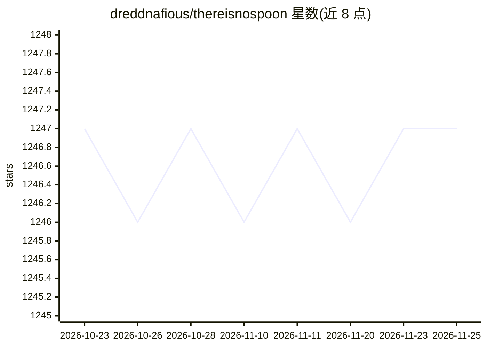

# dreddnafious/thereisnospoon

⭐ 1,247 · Python · MIT · 推送 2026-11-20 · [GitHub](https://github.com/dreddnafious/thereisnospoon) · 个人维护

**为工程师从第一性原理讲解机器学习的入门读物**

以单一 markdown 文件提供的机器学习原理读本，面向有软件工程背景、缺乏 ML 直觉的工程师。内容分三部分：基础（神经元、反向传播、泛化）、架构（卷积/注意力/Transformer/SSM、训练框架）、门控控制。全篇以工程类比作为主要解释手段，附 25 幅由 Python 脚本生成的可视化图，另有一份讲电路与能力形成过程的配套文档及 PDF。建议用法包括让 AI 编码助手围绕文本进行对话式讲解。

## 筛选速览

| 维度 | 判定 | 备注 |
|---|---|---|
| AI 角色 | `ai-knowledge` | 知识聚合/清单类 |
| 许可风险 | `permissive` | MIT |
| 部署形态 | `None` |  |
| 模型依赖 | — | README 未给出锁定关系 |
| 硬件要求 | — | 无带数字的原话,不猜 |
| 安装摩擦 | `low` | 无编译、无系统依赖或容器化 |
| 成熟度 | — | 结构信号不足 |

## 能力要点

- 单一 markdown 文件 + 配套 circuits-primer.pdf 的读本形式
- 25 幅内联可视化图，全部由 scripts/ 下 Python 脚本生成
- 以物理/工程类比（纸张折叠、齿轮链等）作为主要解释方式
- 提供喂给 AI 编码助手进行对话式学习的提示词模板

## 适用场景

- 软件工程师建立机器学习的概念心智模型
- 按 SYLLABUS 主题表逐节自学深度学习基础与 Transformer
- 配合 AI 助手对文本内容做问答式深入探索

## 场景标签

`教程课程` · 领域:学习与行业

## 证据(README 行号)

> L5: A machine learning primer built from first principles.
> L18: This isn't a textbook or a tutorial. It's a **mental model** — the abstractions you need to reason about ML systems
> L49: The primer is a single markdown file with inline visualizations:

## 星数曲线

2026-10-23 1,247 → 2026-11-25 1,247（+0）

---
*卡片 v1 · prompt 1.4 · 生成 2026-11-23 · 置信度 high · 依据 README sha `bef54512aef6` · [字段定义](../../DATASET.md)*
