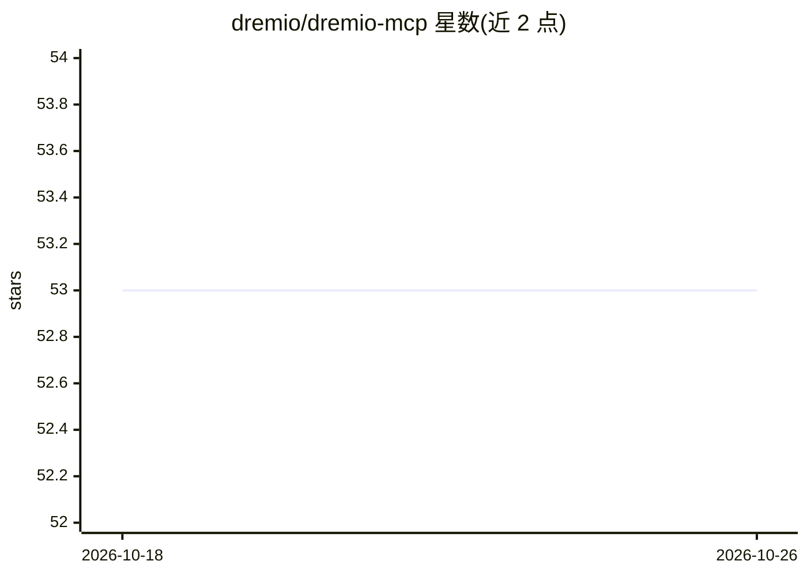

# dremio/dremio-mcp

⭐ 53 · Python · Apache-2.0 · 推送 2026-10-07 · [GitHub](https://github.com/dremio/dremio-mcp) · 组织维护

**连接 Dremio 数据平台的 MCP server，供 LLM 查询数据**

由 Dremio 维护的 Model Context Protocol 服务器，用于让 LLM 前端（如 Claude Desktop）接入 Dremio 数据平台，查看表与数据以发现模式、内省 Dremio 系统及接入 Prometheus 指标。提供本地安装（uv + Python 3.11+）与 Kubernetes 远程 Streaming HTTP 部署（Helm Chart，支持 OAuth、Pod 自动扩缩、TLS）两种方式；通过 YAML 配置 Dremio 连接（URI/PAT/项目 ID）与 Claude 配置文件，日志写入平台特定目录，测试使用 pytest。

## 筛选速览

| 维度 | 判定 | 备注 |
|---|---|---|
| AI 角色 | `ai-ecosystem` | LLM/agent 周边工具 |
| 许可风险 | `permissive` | Apache-2.0 |
| 部署形态 | `self-host` | docker 或自建部署 |
| 模型依赖 | — | README 未给出锁定关系 |
| 硬件要求 | — | 无带数字的原话,不猜 |
| 安装摩擦 | `low` | 无编译、无系统依赖或容器化 |
| 成熟度 | — | 结构信号不足 |

## 能力要点

- 三种运行模式：FOR_DATA_PATTERNS / FOR_SELF / FOR_PROMETHEUS，可逗号分隔组合
- Kubernetes 生产部署：Helm Chart、OAuth + External Token Provider、Prometheus 指标
- 本地运行需 Python 3.11+ 与 uv 包管理器，PAT 可通过文件传入避免进入 shell 历史
- 跨平台日志文件与 JSON 结构化日志选项

## 适用场景

- 在 Claude Desktop 中直接查询和浏览 Dremio 中的表与数据
- 让 LLM 分析 Dremio 系统工作负载与 Prometheus 指标
- 在 Kubernetes 环境以 Helm Chart 部署 MCP server 供生产使用

## 场景标签

`数据分析` · 领域:效率与自动化

## 证据(README 行号)

> L9: This repo provides an **M**odel **C**ontext **P**rotocol (MCP) server for easing LLM integration with Dremio. If you
> L54: The MCP server runs locally on the machine that runs the LLM frontend (eg Claude). The installation steps are simpl
> L153: 1. `FOR_DATA_PATTERNS` - the normal mode where MCP server will allow LLM to look at tables and data to allow patte

## 星数曲线

2026-10-18 53 → 2026-10-26 53（+0）

---
*卡片 v1 · prompt 1.4 · 生成 2026-10-24 · 置信度 high · 依据 README sha `d1f6f9bf9f6b` · [字段定义](../../DATASET.md)*
