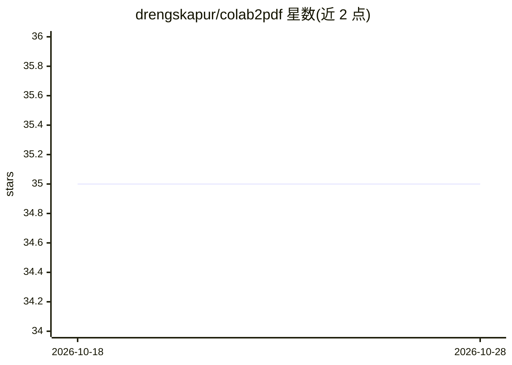

# drengskapur/colab2pdf

⭐ 35 · Python · GPL-3.0 · 推送 2026-07-20 · [GitHub](https://github.com/drengskapur/colab2pdf) · [官网](https://github.com/drengskapur/colab2pdf) · 个人维护

**在 Google Colab 中把笔记本一键转为 PDF 的单元格工具**

以一段可复制粘贴的 Python 单元格形式提供：在 Colab 中运行后自动安装 librsvg2-bin、Quarto 与 TinyTeX 依赖，通过 Colab API 读取当前笔记本内容，过滤掉标记为 --Colab2PDF 的单元格，检查损坏图片 URL，随后用 Quarto 按指定配置转为 PDF 并给出下载链接。提供 ipywidgets 下载按钮与状态标签界面，转换过程含异常处理与按钮状态管理。

## 筛选速览

| 维度 | 判定 | 备注 |
|---|---|---|
| AI 角色 | `ai-ecosystem` | LLM/agent 周边工具 |
| 许可风险 | `viral` | GPL-3.0 |
| 部署形态 | `desktop` | 安装包/桌面程序 |
| 模型依赖 | — | README 未给出锁定关系 |
| 硬件要求 | — | 无带数字的原话,不猜 |
| 安装摩擦 | `low` | 无编译、无系统依赖或容器化 |
| 成熟度 | — | 结构信号不足 |

## 能力要点

- 复制粘贴即可运行，自动安装 librsvg2-bin/Quarto/TinyTeX 依赖
- 通过 Colab API 读取笔记本并用 Quarto 转换为 PDF
- 过滤含 --Colab2PDF 标记的单元格，不进入成品 PDF
- 检测 markdown 中的损坏图片 URL 并在转换前报错

## 适用场景

- 把 Colab 笔记本导出为 PDF 提交作业或报告
- 保留代码与输出的笔记本归档分享

## 场景标签

 · 领域:数据科学工具/笔记本转换

## 证据(README 行号)

> L16:     """Download Google Colab notebook as a PDF.
> L94:  - The notebook is converted to PDF using Quarto with the specified configuration.

## 星数曲线

2026-10-18 35 → 2026-10-28 35（+0）

---
*卡片 v1 · prompt 1.4 · 生成 2026-10-25 · 置信度 mid · 依据 README sha `18f4e32164bc` · [字段定义](../../DATASET.md)*
