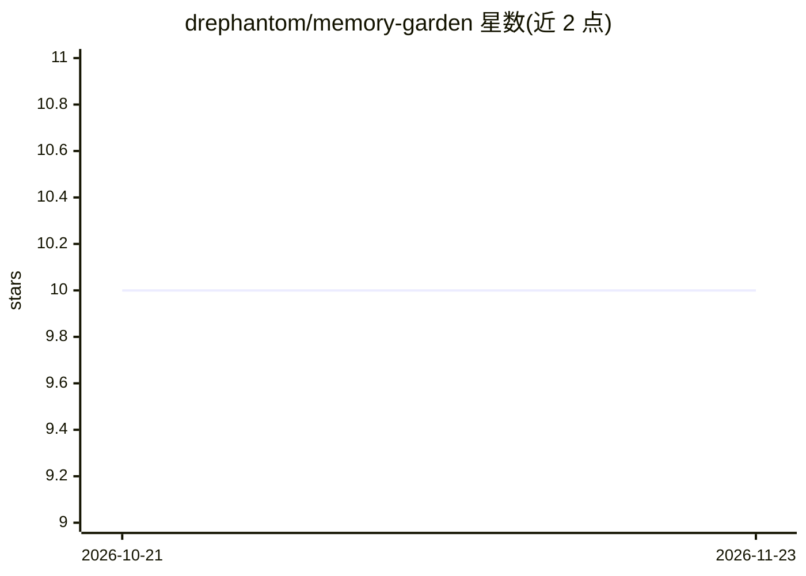

# drephantom/memory-garden

⭐ 10 · Python · MIT · 推送 2026-09-14 · [GitHub](https://github.com/drephantom/memory-garden) · 个人维护 · 中文 README

**连接 Obsidian 笔记的个人记忆助手：回溯观点变化**

本机运行的个人记忆助手，连接 Obsidian 笔记库或导入微信/QQ 聊天记录，围绕主题找回原话、按时间线比较前后表达、生成可核对的解释，用户可确认、补充或撤回判断形成长期记忆。实现上采用带只读工具边界的 Agent 循环（8 个工具，MCP 复用），检索用 RRF 融合关键词与向量候选，程序侧核验引文逐字匹配与来源合法性。自然对话需自行连接生成模型并填写 API Key；离线模式支持查找与规则对照。面向单人本机使用，暂不支持协作与跨设备同步。

## 筛选速览

| 维度 | 判定 | 备注 |
|---|---|---|
| AI 角色 | `ai-native` | 本体是模型或模型工具 |
| 许可风险 | `permissive` | MIT |
| 部署形态 | `None` |  |
| 模型依赖 | — | README 未给出锁定关系 |
| 硬件要求 | — | 无带数字的原话,不猜 |
| 安装摩擦 | `low` | 无编译、无系统依赖或容器化 |
| 成熟度 | — | 结构信号不足 |

## 能力要点

- 带边界的 Agent 工具循环与引用逐字核验，区分原话、解释与未知项
- RRF 融合关键词与向量检索，默认本地哈希向量，可配置语义 Embedding 与 Rerank
- 长期记忆只采用用户确认的判断，支持修正与撤回，按笔记库隔离
- 支持 Web/CLI/MCP 三种入口与微信/QQ 聊天片段导入

## 适用场景

- 在 Obsidian 笔记中回看某个想法如何随时间变化
- 导入微信/QQ 聊天记录后按主题检索原话
- 以可核对引用的方式维护一个可修正的个人记忆库

## 场景标签

`Agent 记忆` `知识库管理` `文档问答` · 领域:Agent 开发

## 证据(README 行号)

> L14: Memory Garden 是一个个人记忆助手。连接 Obsidian 笔记库，或导入自己选择的聊天记录，围绕一个主题找回原话、比较前后表达，并修正助手对你的理解。
> L103: 模型负责理解问题、选择工具和提出解释；程序负责限制证据范围、核对引用，并保存用户主动确认的判断。一次有明确主题的回溯通常沿着以下过程展开，工具顺序由 Agent 根据已有观察选择：
> L146: Memory Garden 使用一个带只读工具的 Agent：先理解这一轮想聊什么，再决定是否查阅记录。回溯时，模型可以根据工具返回的证据继续查找，把原话、可能的解释和仍未确认的问题分开呈现。

## 星数曲线

2026-10-21 10 → 2026-11-23 10（+0）

---
*卡片 v1 · prompt 1.4 · 生成 2026-11-19 · 置信度 high · 依据 README sha `bb22a6eb3085` · [字段定义](../../DATASET.md)*
