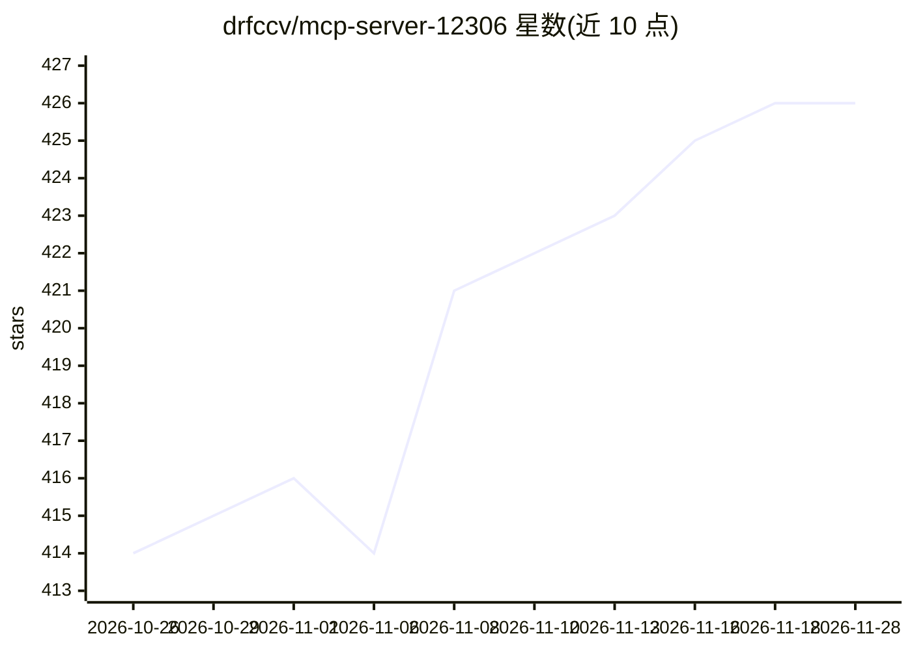

# drfccv/mcp-server-12306

⭐ 426 · Python · MIT · 推送 2026-11-23 · [GitHub](https://github.com/drfccv/mcp-server-12306) · 个人维护 · 中文 README

**给 AI 助手提供 12306 火车票查询能力的 MCP 服务器**

基于 Model Context Protocol 的火车票查询后端，提供余票、票价、车站搜索、经停站、中转换乘、时间工具共 7 个 MCP 工具，数据来自 12306 官方公开接口。支持 Stdio（本地客户端）与 Streamable HTTP（远程部署）双传输模式，两种模式共享同一核心实例；提供 /health、/schema/tools 等 HTTP 端点与环境变量配置。通过 PyPI、Docker 镜像或源码部署，声明仅供学习研究、禁止商用。

## 筛选速览

| 维度 | 判定 | 备注 |
|---|---|---|
| AI 角色 | `ai-ecosystem` | LLM/agent 周边工具 |
| 许可风险 | `permissive` | MIT |
| 部署形态 | `self-host` | docker 或自建部署 |
| 模型依赖 | — | README 未给出锁定关系 |
| 硬件要求 | — | 无带数字的原话,不猜 |
| 安装摩擦 | `low` | 无编译、无系统依赖或容器化 |
| 成熟度 | — | 结构信号不足 |

## 能力要点

- 提供 7 个 MCP 工具：余票/票价/车站/经停/换乘/时间/车次号映射
- Stdio 与 Streamable HTTP 双传输模式，共享同一核心实例
- 支持中文/拼音/简拼/三字码的 3400+ 车站模糊搜索
- 网络请求带自动重试与会话保持

## 适用场景

- 在 Claude Desktop、Cursor 等本地客户端中查询火车票信息
- 远程部署 HTTP 服务供自动化脚本调用 12306 数据
- 为出行规划 Agent 提供余票与中转换乘数据源

## 场景标签

 · 领域:出行/LLM 工具生态

## 证据(README 行号)

> L3: **基于 Model Context Protocol (MCP) 的 12306 火车票查询服务**
> L14: 支持 **余票 / 票价 / 车站 / 经停 / 换乘 / 时间** 六大查询能力，开箱即用，适配 AI 助手、自动化脚本、智能终端等场景。
> L47: > MCP Server 通过标准输入/输出与客户端通信，**不占用网络端口**，适合 Claude Desktop、Cursor 等本地 MCP 客户端。

## 星数曲线

2026-10-26 414 → 2026-11-28 426（+12）

---
*卡片 v1 · prompt 1.4 · 生成 2026-11-25 · 置信度 high · 依据 README sha `bb6c92f05e38` · [字段定义](../../DATASET.md)*
