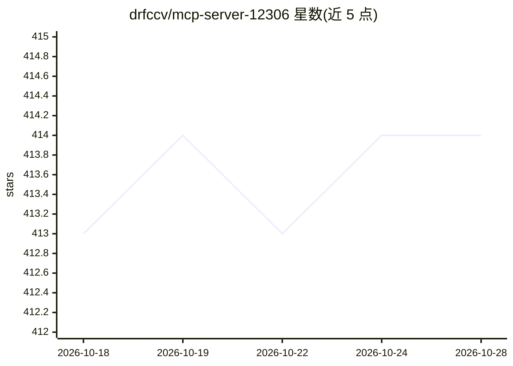

# drfccv/mcp-server-12306

⭐ 415 · Python · MIT · 推送 2026-09-30 · [GitHub](https://github.com/drfccv/mcp-server-12306) · 个人维护 · 中文 README

**为 AI 客户端提供 12306 火车票查询的 MCP 服务器**

基于 Model Context Protocol（MCP SDK v2）的 12306 数据查询后端：通过标准化工具接口提供余票、票价、车站搜索（3382+ 车站，中文/拼音/简拼/三字码）、中转换乘、列车经停站与时间查询，覆盖官方 12306 公开接口的聚合转发。支持 Stdio 本地与 Streamable HTTP 远程两种传输模式，复用同一核心实例；可通过 uvx/pip/pipx 安装，或用 Docker 部署。面向 Claude Desktop、Cursor 等 MCP 客户端用户及自动化脚本开发者。项目声明仅供学习研究、禁止商用。

## 筛选速览

| 维度 | 判定 | 备注 |
|---|---|---|
| AI 角色 | `ai-ecosystem` | LLM/agent 周边工具 |
| 许可风险 | `permissive` | MIT |
| 部署形态 | `self-host` | docker 或自建部署 |
| 模型依赖 | — | README 未给出锁定关系 |
| 硬件要求 | — | 无带数字的原话,不猜 |
| 安装摩擦 | `low` | 无编译、无系统依赖或容器化 |
| 成熟度 | — | 结构信号不足 |

## 能力要点

- 六大查询能力：余票/票价/车站/换乘/经停/时间，共 7 个 MCP 工具
- Stdio 与 Streamable HTTP 双传输模式共享同一核心实例
- 车站模糊搜索覆盖全国 3382+ 车站（中文/拼音/简拼/三字码）
- 提供 uvx/pip/pipx 安装、源码运行与 Docker 部署三种方式

## 适用场景

- 在 Claude Desktop / Cursor 等 MCP 客户端中直接查询火车票余票与票价
- 自动化脚本或智能终端获取 12306 实时数据
- 通过 HTTP 远程部署供多客户端共享调用

## 场景标签

 · 领域:出行服务/AI 工具服务

## 证据(README 行号)

> L3: **基于 Model Context Protocol (MCP) 的 12306 火车票查询服务**
> L30: |🔌 **双传输模式**|Stdio（本地）\|Streamable HTTP（远程），同一核心实例共享|

## 星数曲线

2026-10-18 413 → 2026-10-28 414（+1）

---
*卡片 v1 · prompt 1.4 · 生成 2026-10-21 · 置信度 high · 依据 README sha `c0301e71a3ae` · [字段定义](../../DATASET.md)*
