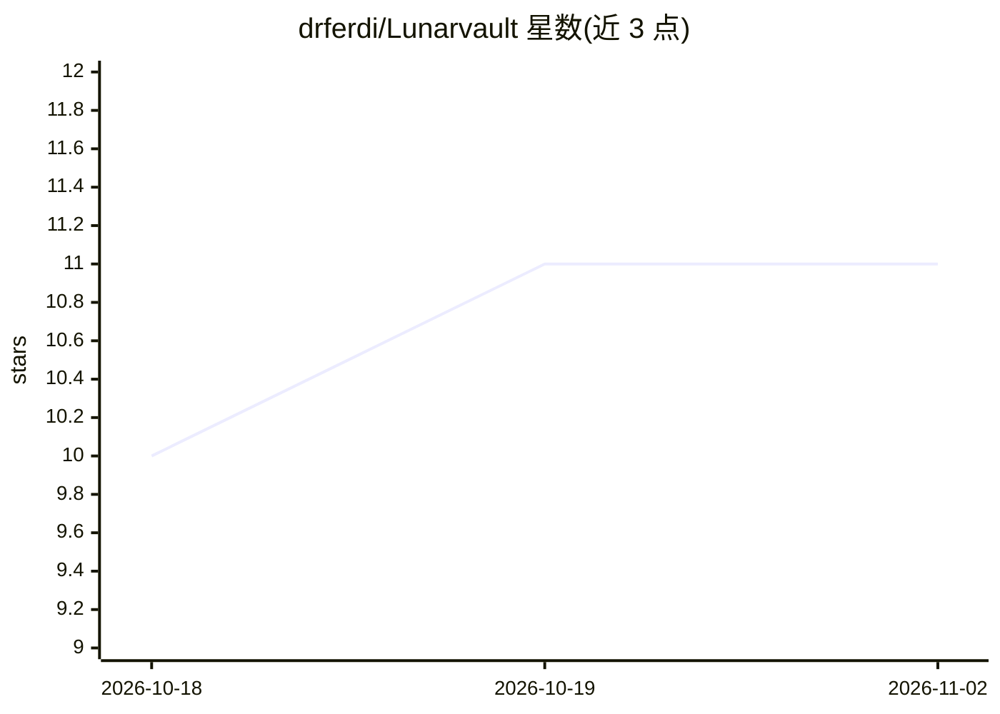

# drferdi/Lunarvault

⭐ 11 · PowerShell · MIT · 推送 2026-07-03 · [GitHub](https://github.com/drferdi/Lunarvault) · 个人维护

**给 Codex 用户的可移植记忆系统覆盖包：本地检索与上下文注入**

Lunar Vault 是面向 Codex 运行时的可分发记忆系统覆盖包（overlay），打包原生 hook 插件、PowerShell 记忆操作脚本、本地 ONNX 检索模型（multilingual-e5-small 稠密编码器 + bge-reranker-v2-m3 交叉编码器重排）、系统文档与安装器。安装到 CODEX_HOME 或 %USERPROFILE%\.codex，会话启动时由 hook 预载上下文。设计上排除个人记忆状态、凭据与缓存等私密数据。主要平台为 Windows，非完整 Codex 安装器，也自称尚非通用 agent 记忆平台。

## 筛选速览

| 维度 | 判定 | 备注 |
|---|---|---|
| AI 角色 | `ai-ecosystem` | LLM/agent 周边工具 |
| 许可风险 | `permissive` | MIT |
| 部署形态 | `desktop` | 安装包/桌面程序 |
| 模型依赖 | — | README 未给出锁定关系 |
| 硬件要求 | — | 无带数字的原话,不猜 |
| 安装摩擦 | `low` | 无编译、无系统依赖或容器化 |
| 成熟度 | — | 结构信号不足 |

## 能力要点

- 本地两阶段检索：ONNX 稠密编码 + ONNX 交叉编码器重排
- 原生 hook 插件在会话启动时注入范围化上下文
- 安装器默认排除私密状态与凭据，生成机器本地 hooks.json
- 提供仓库克隆与便携 ZIP 两种安装模式

## 适用场景

- 把 Lunar 记忆系统安全地安装到我的 Codex 主目录
- 让 Codex 会话自动预载相关记忆上下文
- 通过 GitHub 或 ZIP 向他人分发可复现的记忆运行时组件

## 场景标签

`Agent 记忆` · 领域:Agent 开发

## 证据(README 行号)

> L21:  Lunar Vault is a portable distribution package for the Lunar memory system used inside Codex. It packages the runt
> L63: |Retrieval stack|Local ONNX dense encoder + local ONNX cross-encoder reranker|
> L148: Lunar Vault packages a local two-stage retrieval stack.

## 星数曲线

2026-10-18 10 → 2026-11-02 11（+1）

---
*卡片 v1 · prompt 1.4 · 生成 2026-11-02 · 置信度 high · 依据 README sha `2c72d4109eb8` · [字段定义](../../DATASET.md)*
