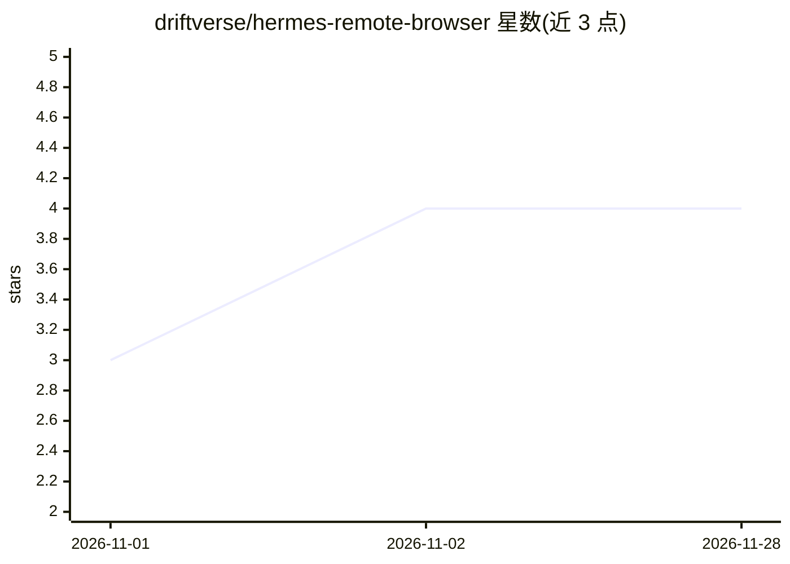

# driftverse/hermes-remote-browser

⭐ 4 · JavaScript · MIT · 推送 2026-11-02 · [GitHub](https://github.com/driftverse/hermes-remote-browser) · 个人维护

**让服务器上的 Hermes Agent 远程使用本地 Chrome 的插件与中继**

由浏览器扩展和服务器端 relay.py 组成：本地 Chrome 安装扩展后向外拨出 wss 连接，无需开放端口、VPN 或伴侣程序；服务器上的 Hermes Agent 通过 remote_browser 工具读取共享标签页的文本与截图，执行打开、点击、输入、滚动、截图等操作。安全机制包括紫色 Hermes 标签组隔离访问范围、默认关闭与定时自动关闭、密码字段禁读写、配对码与 token 哈希存储。依赖公网 HTTPS 主机名（websocket 支持）与 Chrome 116+。

## 筛选速览

| 维度 | 判定 | 备注 |
|---|---|---|
| AI 角色 | `ai-ecosystem` | LLM/agent 周边工具 |
| 许可风险 | `permissive` | MIT |
| 部署形态 | `desktop` | 安装包/桌面程序 |
| 模型依赖 | — | README 未给出锁定关系 |
| 硬件要求 | — | 无带数字的原话,不猜 |
| 安装摩擦 | `low` | 无编译、无系统依赖或容器化 |
| 成熟度 | `idea` | |

## 能力要点

- 扩展向外拨出连接，本地不开端口、无需 VPN 客户端
- 标签组隔离：Agent 仅能访问紫色 Hermes 组内的标签页
- 复用本地已登录的浏览器会话，无需复制 cookie 到服务器
- 配对码机制，服务器只存 token 的 SHA-256 哈希

## 适用场景

- 家庭服务器/VPS 上的 Agent 操作我本地已登录的网站
- 让 Agent 先查 GitHub 是否已有重复 issue 再操作
- homelab 场景下远程自动化日常网页任务

## 场景标签

`浏览器自动化` · 领域:效率与自动化

## 证据(README 行号)

> L5: Let a Hermes Agent on a home server or VPS use
> L48: hermes plugins install driftverse/hermes-remote-browser --enable
> L92: - **The relay runs itself.** The plugin starts `relay.py` in the background when Hermes loads it,

## 星数曲线

2026-11-01 3 → 2026-11-28 4（+1）

---
*卡片 v1 · prompt 1.4 · 生成 2026-11-21 · 置信度 mid · 依据 README sha `ff49a93c1ab5` · [字段定义](../../DATASET.md)*
