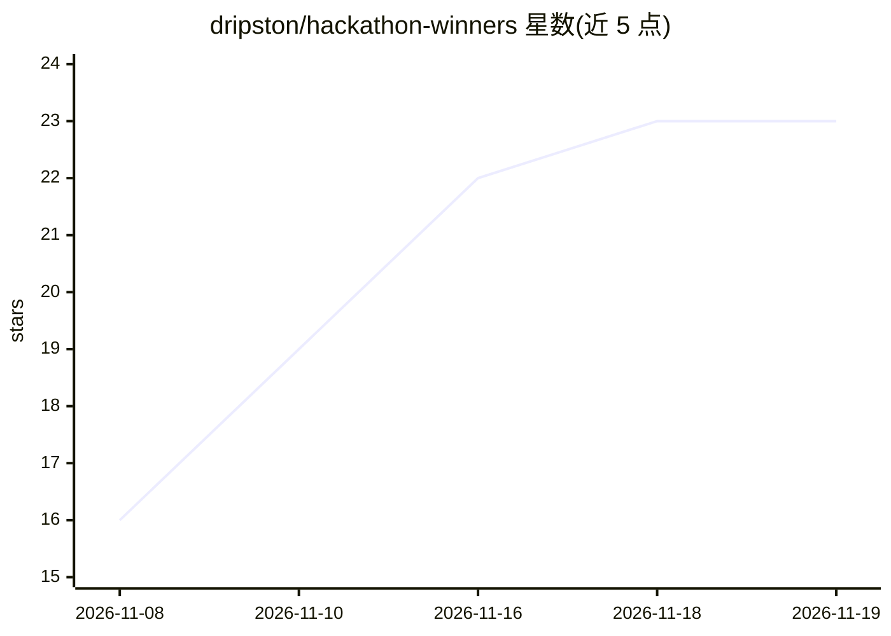

# dripston/hackathon-winners

⭐ 23 · 推送 2026-11-04 · [GitHub](https://github.com/dripston/hackathon-winners) · 个人维护

**软件黑客松获奖项目链接策展清单（AI/Web3/学生/全球赛事）**

聚合各类黑客松获奖项目直达链接的 Awesome 清单：覆盖全球性赛事（NASA Space Apps、Imagine Cup、Smart India Hackathon）、学生赛事（TreeHacks、Cal Hacks、HackMIT）、线上大型赛（Bolt、OpenAI Build Week、AWS AI Agent）、开发者平台（Devpost、DEV、Hashnode）、Web3（ETHGlobal、ETHIndia）等类别，含获奖项目名次页、决赛名单与项目画廊链接，并附各平台获奖页 URL 模式。纯链接目录，无安装运行步骤，License 为 CC0，接受 PR。

## 筛选速览

| 维度 | 判定 | 备注 |
|---|---|---|
| AI 角色 | `ai-knowledge` | 知识聚合/清单类 |
| 许可风险 | `none` | — |
| 部署形态 | `None` |  |
| 模型依赖 | — | README 未给出锁定关系 |
| 硬件要求 | — | 无带数字的原话,不猜 |
| 安装摩擦 | `low` | 无编译、无系统依赖或容器化 |
| 成熟度 | — | 结构信号不足 |

## 能力要点

- 按全球赛事/学生/线上/平台/Web3 等 9 个板块组织获奖链接
- Hall of Fame 摘录 12 个获奖项目及所属赛事
- 提供各平台查找更多获奖者的 URL 模式

## 适用场景

- 研究历届黑客松获奖项目的选题与技术栈
- 为参赛或副业项目寻找灵感
- 调研学生与开发者社群的作品生态

## 场景标签

`精选清单` · 领域:学习与行业

## 证据(README 行号)

> L3: **Real winning projects from the world's biggest hackathons, all in one place.**
> L5: Direct links to winners pages, finalist lists and project galleries from AI, Web3, student, corporate and global hac
> L21: ## 📚 Contents

## 星数曲线

2026-11-08 16 → 2026-11-19 23（+7）

---
*卡片 v1 · prompt 1.4 · 生成 2026-11-18 · 置信度 high · 依据 README sha `01b08cfb778c` · [字段定义](../../DATASET.md)*
