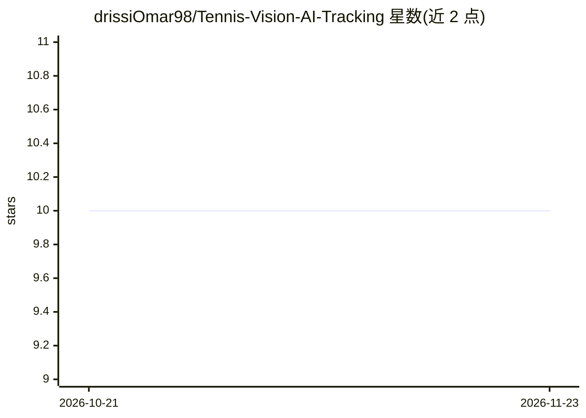

# drissiOmar98/Tennis-Vision-AI-Tracking

⭐ 10 · Jupyter Notebook · 推送 2026-01-17 · [GitHub](https://github.com/drissiOmar98/Tennis-Vision-AI-Tracking) · 个人维护

**网球视频分析系统：检测追踪球员与球并输出指标**

端到端网球视频分析系统：用 Ultralytics YOLOv8 检测追踪球员、微调模型检测高速小球，并以 ResNet50 CNN 回归 14 个场地关键点做像素到真实坐标的映射。输出击球速度、球员跑动距离、轨迹重建与战术可视化（迷你球场叠加、热力图、落点图），支持 MP4/CSV/JSON 多格式导出，并提供检测结果的序列化存根以加速迭代。面向教练、球探与运动分析场景。

## 筛选速览

| 维度 | 判定 | 备注 |
|---|---|---|
| AI 角色 | `ai-native` | 本体是模型或模型工具 |
| 许可风险 | `none` | — |
| 部署形态 | `None` |  |
| 模型依赖 | — | README 未给出锁定关系 |
| 硬件要求 | — | 无带数字的原话,不猜 |
| 安装摩擦 | `low` | 无编译、无系统依赖或容器化 |
| 成熟度 | — | 结构信号不足 |

## 能力要点

- YOLOv8 球员检测 + 微调模型的小目标球检测
- DeepSORT 式带身份追踪，稳定 Track ID 聚合单人指标
- ResNet50 回归 14 个场地关键点，实现像素→米级坐标转换
- 输出 MP4/CSV/JSON 多格式结果导出

## 适用场景

- 从比赛视频中计算击球速度与球员跑动数据
- 生成球员热力图与落点图辅助战术分析
- 用于球探报告与运动表现数据采集

## 场景标签

`目标检测` `微调` `数据分析` · 领域:效率与自动化

## 证据(README 行号)

> L3: An **end-to-end, production-grade tennis video analysis system** leveraging state-of-the-art computer vision and dee
> L17: |**📐 Court Coordinate Regression**|ResNet50 backbone outputs 14 (x, y) court keypoints for homography estimation.|E

## 星数曲线

2026-10-21 10 → 2026-11-23 10（+0）

---
*卡片 v1 · prompt 1.4 · 生成 2026-11-19 · 置信度 high · 依据 README sha `f1364b724fa0` · [字段定义](../../DATASET.md)*
