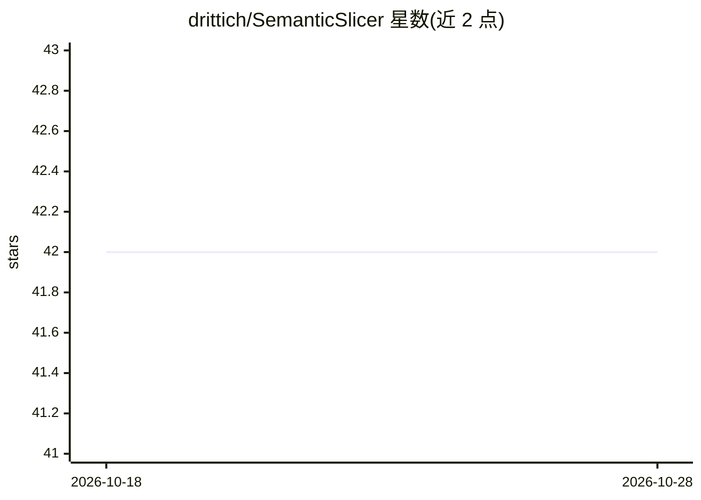

# drittich/SemanticSlicer

⭐ 42 · C# · MIT · 推送 2026-02-26 · [GitHub](https://github.com/drittich/SemanticSlicer) · [官网](https://drittich.github.io/SemanticSlicer/) · 个人维护

**面向 LLM 嵌入的 C# 文本语义分块库**

轻量级 C#（.NET 8）分块库与 CLI：递归切分文本并保留句子、标题、HTML 标签等语义边界，可配置分隔符、最大 chunk token 数（默认 1,000，cl100k_base 编码计数）、重叠比例与剥离 HTML 标签，输出含偏移量、索引与自定义元数据的分块，面向生成嵌入（OpenAI/Azure OpenAI/LangChain 等）前的文档预处理。提供 NuGet 包、四平台预编译二进制（自包含、无需 .NET 运行时）、daemon 模式、systemd/Windows 服务与 REST API；也可 dotnet publish 源码构建。

## 筛选速览

| 维度 | 判定 | 备注 |
|---|---|---|
| AI 角色 | `ai-ecosystem` | LLM/agent 周边工具 |
| 许可风险 | `permissive` | MIT |
| 部署形态 | `desktop` | 安装包/桌面程序 |
| 模型依赖 | — | README 未给出锁定关系 |
| 硬件要求 | — | 无带数字的原话,不猜 |
| 安装摩擦 | `medium` | 含编译或系统依赖之一 |
| 成熟度 | — | 结构信号不足 |

## 动量与使用信号

- 下载:GitHub Release 附件 累计 245(7 个 release)

## 能力要点

- 递归分块并保留句子/标题/HTML 等语义边界，支持自定义分隔符
- 可配置最大 token 数与重叠比例（cl100k_base 编码计数）
- 预编译自包含二进制，支持 CLI/daemon/后台服务/REST API 四种运行形态
- 分块携带偏移量、索引与自定义元数据，可附加标题头

## 适用场景

- RAG 入库前把文档切成语义完整的分块再生成嵌入
- 通过 REST 服务或 daemon 常驻进程批量处理切分请求
- 在 .NET 代码中以库形式对 Markdown/HTML/纯文本做 token 感知分块

## 场景标签

 · 领域:LLM 基础设施/文档处理

## 证据(README 行号)

> L8: **SemanticSlicer** is a lightweight C# application that **recursively splits text** into meaningful chunks—preservin
> L16: This library accepts text and will break it into smaller chunks, typically useful for when creating LLM AI embeddin

## 星数曲线

2026-10-18 42 → 2026-10-28 42（+0）

---
*卡片 v1 · prompt 1.4 · 生成 2026-10-18 · 置信度 high · 依据 README sha `a2f6e5d65652` · [字段定义](../../DATASET.md)*
