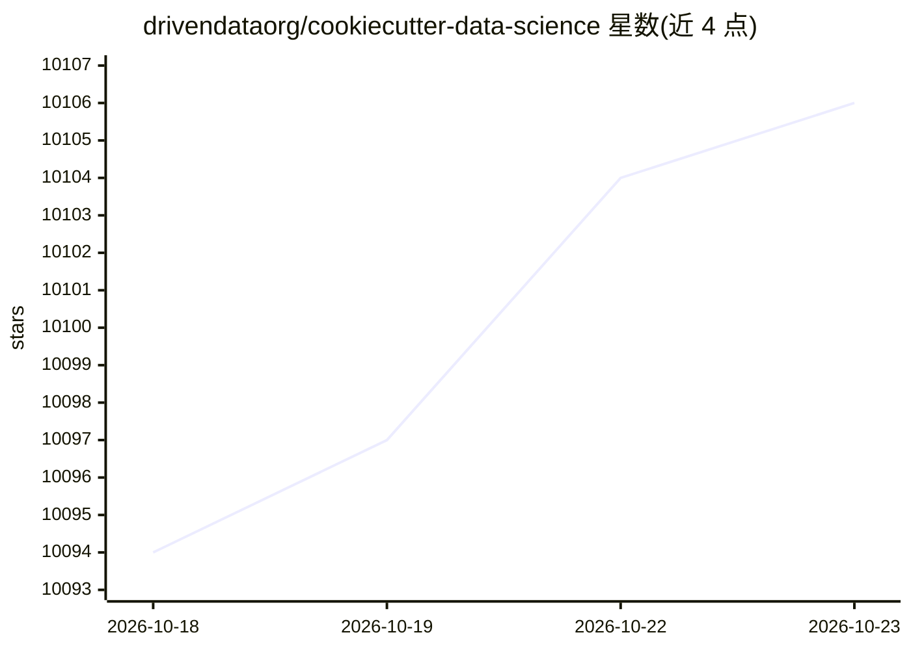

# drivendataorg/cookiecutter-data-science

⭐ 10,106 · Python · MIT · 推送 2026-10-03 · [GitHub](https://github.com/drivendataorg/cookiecutter-data-science) · [官网](https://cookiecutter-data-science.drivendata.org/) · 组织维护

**数据科学项目模板生成工具：标准化项目结构脚手架**

基于 cookiecutter 模板机制的项目脚手架：通过 ccds 命令行程序交互式生成包含数据、模型、文档等目录的数据科学项目结构，内置 Makefile 等约定。v2 起以独立 Python 包发布（需 Python 3.10+），扩展了 cookiecutter 模板工具的功能，并支持 -c 参数切换模板版本（含旧版 v1）。面向数据科学/机器学习开发者，由 DrivenData 维护。不提供模型或数据处理功能本身，仅生成项目骨架。

## 筛选速览

| 维度 | 判定 | 备注 |
|---|---|---|
| AI 角色 | `ai-ecosystem` | LLM/agent 周边工具 |
| 许可风险 | `permissive` | MIT |
| 部署形态 | `library` | 以包/库形式分发 |
| 模型依赖 | — | README 未给出锁定关系 |
| 硬件要求 | — | 无带数字的原话,不猜 |
| 安装摩擦 | `low` | 无编译、无系统依赖或容器化 |
| 成熟度 | — | 结构信号不足 |

## 能力要点

- ccds 命令行程序生成交互式配置的项目结构
- v2 以独立 Python 包扩展 cookiecutter 模板功能
- 支持 -c/--checkout 切换模板版本（分支/标签/commit）
- 保留 v1 旧模板使用路径

## 适用场景

- 新建数据科学项目时获得标准化目录结构
- 团队统一数据科学项目的组织约定
- 复用旧版 v1 模板结构

## 场景标签

`代码生成` · 领域:编码与开发

## 证据(README 行号)

> L12: **Cookiecutter Data Science (CCDS)** is a tool for setting up a data science project template that incorporates bes
> L14: > ℹ️ Cookiecutter Data Science v2 has changed from v1. It now requires installing the new cookiecutter-data-science

## 星数曲线

2026-10-18 10,094 → 2026-10-23 10,106（+12）

---
*卡片 v1 · prompt 1.4 · 生成 2026-10-20 · 置信度 mid · 依据 README sha `7fe22bcf4a96` · [字段定义](../../DATASET.md)*
