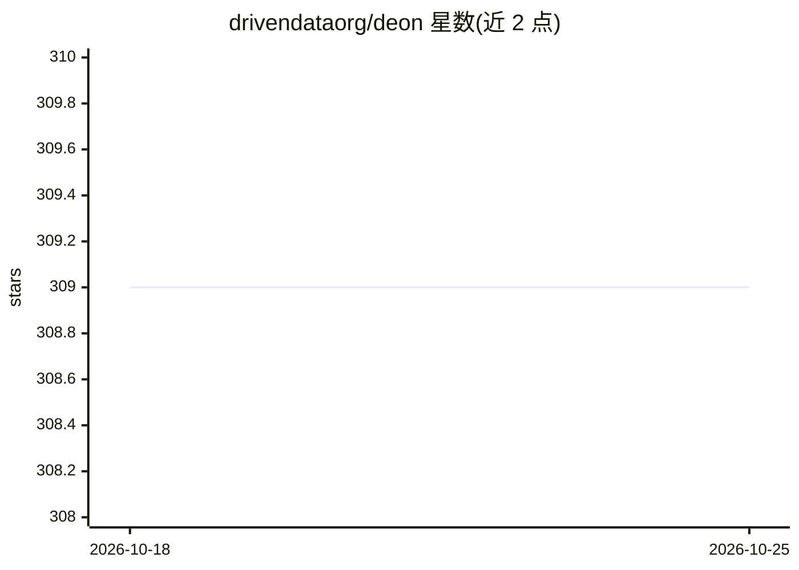

# drivendataorg/deon

⭐ 309 · Python · MIT · 推送 2026-10-23 · [GitHub](https://github.com/drivendataorg/deon) · [官网](https://deon.drivendata.org/) · 组织维护

**为数据科学项目生成伦理检查清单的命令行工具**

deon 是一个 Python 命令行工具，用于在数据科学项目中创建或追加数据科学伦理检查清单：内置一份默认清单，覆盖数据收集、存储、分析、建模、部署五大环节共数十个检查项，每项附真实案例；支持输出为 txt/html/ipynb/md/rmd/rst 六种格式，文件已存在时自动追加。用户可通过自定义 checklist.yml 维护团队专属清单并以 -l 传入。需 Python>3.8 运行，经 pip/conda 安装，也可用 uvx 免安装直接运行。

## 筛选速览

| 维度 | 判定 | 备注 |
|---|---|---|
| AI 角色 | `ai-knowledge` | 知识聚合/清单类 |
| 许可风险 | `permissive` | MIT |
| 部署形态 | `library` | 以包/库形式分发 |
| 模型依赖 | — | README 未给出锁定关系 |
| 硬件要求 | — | 无带数字的原话,不猜 |
| 安装摩擦 | `low` | 无编译、无系统依赖或容器化 |
| 成熟度 | — | 结构信号不足 |

## 能力要点

- 内置默认伦理清单，5 大环节（收集/存储/分析/建模/部署）检查项并附真实案例
- 支持 txt/html/jupyter/markdown/rmarkdown/rst 六种输出格式，已存在文件自动追加
- 支持通过自定义 checklist.yml（-l 参数）维护团队专属清单
- 可用 uvx deon 一行命令免安装生成 ETHICS.md

## 适用场景

- 在项目启动时生成 ETHICS.md 作为伦理评审起点
- 把检查清单追加到 Jupyter/RMarkdown 分析文档中
- 团队按自身领域关注点维护自定义伦理清单

## 场景标签

 · 领域:数据科学/伦理治理

## 证据(README 行号)

> L7: `deon` is a command line tool that allows you to easily add an ethics checklist to your data science projects. We su
> L144: # Data Science Ethics Checklist

## 星数曲线

2026-10-18 309 → 2026-10-25 309（+0）

---
*卡片 v1 · prompt 1.4 · 生成 2026-10-21 · 置信度 high · 依据 README sha `f392ff0541fb` · [字段定义](../../DATASET.md)*
