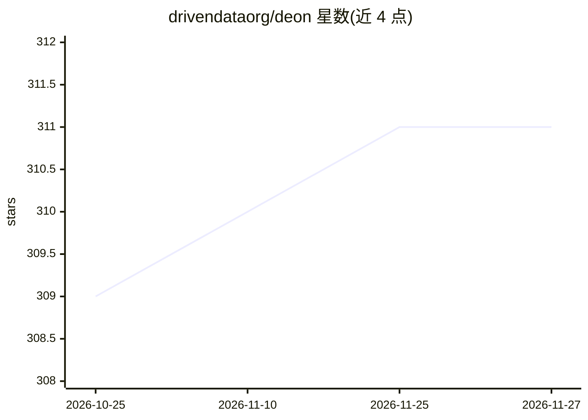

# drivendataorg/deon

⭐ 311 · Python · MIT · 推送 2026-11-03 · [GitHub](https://github.com/drivendataorg/deon) · [官网](https://deon.drivendata.org/) · 组织维护

**为数据科学项目生成伦理检查清单的命令行工具**

deon 是一个 Python 命令行工具，用于向数据科学项目中添加伦理检查清单。内置一份默认的数据科学伦理清单（涵盖数据收集、存储、分析、建模、部署五个部分，共 21 条），每条附真实案例链接；支持输出为 txt/html/jupyter/md/rmd/rst 等格式，可新建独立清单文件或追加到已有分析文件，已存在文件时自动追加。用户也可通过 checklist.yml 定义自定义清单，用 -l 参数传入。需 Python 3.8 以上运行。

## 筛选速览

| 维度 | 判定 | 备注 |
|---|---|---|
| AI 角色 | `ai-knowledge` | 知识聚合/清单类 |
| 许可风险 | `permissive` | MIT |
| 部署形态 | `library` | 以包/库形式分发 |
| 模型依赖 | — | README 未给出锁定关系 |
| 硬件要求 | — | 无带数字的原话,不猜 |
| 安装摩擦 | `low` | 无编译、无系统依赖或容器化 |
| 成熟度 | — | 结构信号不足 |

## 能力要点

- 内置 5 部分 21 条的默认数据科学伦理清单，并附真实案例
- 支持输出/追加到 jupyter、markdown、rmarkdown 等 6 种格式
- 支持通过 checklist.yml 自定义清单 schema
- 提供 uvx 一行运行与 pip/conda 安装

## 适用场景

- 在数据科学项目启动时生成 ETHICS.md 作为团队讨论起点
- 把伦理清单追加到现有 Jupyter notebook 分析中
- 团队用自定义 checklist.yml 落地领域专属伦理检查项

## 场景标签

 · 领域:数据科学/伦理治理

## 证据(README 行号)

> L7: `deon` is a command line tool that allows you to easily add an ethics checklist to your data science projects. We su

## 星数曲线

2026-10-25 309 → 2026-11-27 311（+2）

---
*卡片 v1 · prompt 1.4 · 生成 2026-11-25 · 置信度 high · 依据 README sha `b03de142287f` · [字段定义](../../DATASET.md)*
