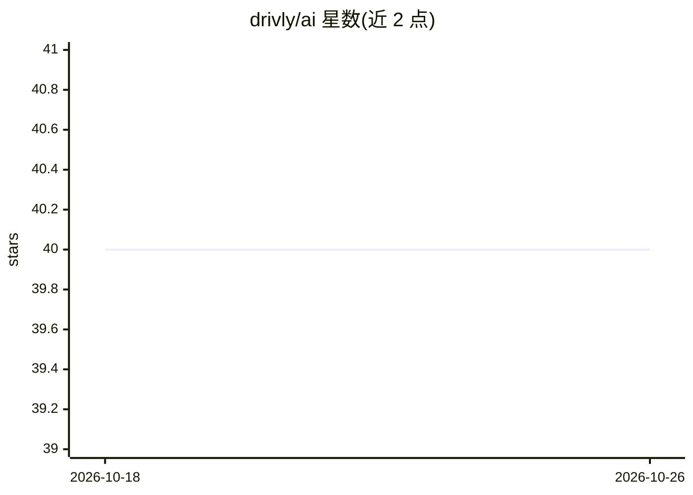

# drivly/ai

⭐ 40 · TypeScript · MIT · 推送 2026-02-04 · [GitHub](https://github.com/drivly/ai) · [官网](https://workflows.do) · 组织维护

**AI 原生工作流平台：函数、Agent、评测、数据库一体化 SDK**

以 .do 命名的系列产品族组成的 Agentic 工作流平台：functions.do 提供无 Schema 或类型安全 Schema 的对象/文本/列表生成，agents.do 提供研究、浏览与自主执行 Agent，humans.do 将人工审批纳入工作流，evals.do 与 experiments.do 用于模型评测与快速迭代，workflows.do 支持事件驱动与定时函数，database.do 提供无 Schema 集合、嵌入向量搜索与关系定义。面向以 TypeScript/Next.js 构建服务的开发者，MIT 许可，模型与推理依赖多家外部供应商。

## 筛选速览

| 维度 | 判定 | 备注 |
|---|---|---|
| AI 角色 | `ai-ecosystem` | LLM/agent 周边工具 |
| 许可风险 | `permissive` | MIT |
| 部署形态 | `None` |  |
| 模型依赖 | — | README 未给出锁定关系 |
| 硬件要求 | — | 无带数字的原话,不猜 |
| 安装摩擦 | `low` | 无编译、无系统依赖或容器化 |
| 成熟度 | — | 结构信号不足 |

## 能力要点

- functions.do 支持 Schema 与类型安全 Schema 的对象/文本/列表生成
- agents.do 提供研究、网页浏览与自主执行 Agent
- evals.do / experiments.do 用于模型评测与快速迭代
- database.do 集成嵌入与向量搜索，workflows.do 支持事件与定时函数

## 适用场景

- 用自然语言生成结构化业务对象并纳入事件驱动工作流
- 构建带人工审批环节的 Agent 客服或运营流程
- 在统一平台内做模型评测与实验对比

## 场景标签

`工作流自动化` `模型评测` `Agent 框架` · 领域:Agent 开发

## 证据(README 行号)

> L8: import { ai } from 'functions.do'
> L10: const brand = await ai.storyBrand({ idea: 'Auto Loan Underwriting Services-as-Software' })
> L96: on('User.Signup', async (event, { ai, api, db }) => {

## 星数曲线

2026-10-18 40 → 2026-10-26 40（+0）

---
*卡片 v1 · prompt 1.4 · 生成 2026-10-25 · 置信度 mid · 依据 README sha `b0a7cc316a0c` · [字段定义](../../DATASET.md)*
