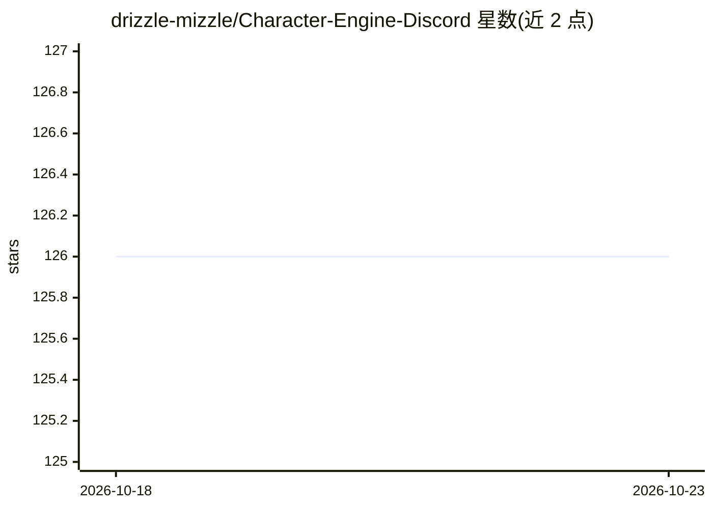

# drizzle-mizzle/Character-Engine-Discord

⭐ 126 · C# · GPL-3.0 · 推送 2026-05-28 · [GitHub](https://github.com/drizzle-mizzle/Character-Engine-Discord) · [官网](https://discord.gg/JtVzgJ8Znh) · 个人维护

**Discord 服务器内的 LLM 聊天角色聚合机器人**

以 Discord Bot 形式运行的 LLM 聚合器：基于 Discord Webhooks 创建 AI 驱动的虚拟角色，聚合 CharacterAI、SakuraAI、OpenRouter、ChubAI 等多个在线平台。支持单频道最多 15 个角色、整服不限数量，内置角色浏览器，并提供按服务器/频道/角色的分级配置。通过邀请链接添加到 Discord 服务器使用，README 暂未给出自行部署的安装说明。

## 筛选速览

| 维度 | 判定 | 备注 |
|---|---|---|
| AI 角色 | `ai-native` | 本体是模型或模型工具 |
| 许可风险 | `viral` | GPL-3.0 |
| 部署形态 | `None` |  |
| 模型依赖 | locked-api |  |
| 硬件要求 | — | 无带数字的原话,不猜 |
| 安装摩擦 | `low` | 无编译、无系统依赖或容器化 |
| 成熟度 | `idea` | |

## 能力要点

- 聚合 CharacterAI/SakuraAI/OpenRouter/ChubAI 多个平台
- 基于 Discord Webhooks 的 AI 角色生成
- 单频道最多 15 个角色，整服不限量
- 服务器/频道/角色三级配置

## 适用场景

- 在 Discord 服务器中创建多个 AI 聊天角色活跃气氛
- 为不同频道和角色设置不同的平台与参数

## 场景标签

`聊天机器人` · 领域:对话与助手

## 证据(README 行号)

> L3: **Character Engine** is a powerful aggregator of various online platforms in the form of a Discord bot that allows y
> L11: - OpenRouter

## 星数曲线

2026-10-18 126 → 2026-10-23 126（+0）

---
*卡片 v1 · prompt 1.4 · 生成 2026-10-23 · 置信度 mid · 依据 README sha `eca2ba8405ef` · [字段定义](../../DATASET.md)*
