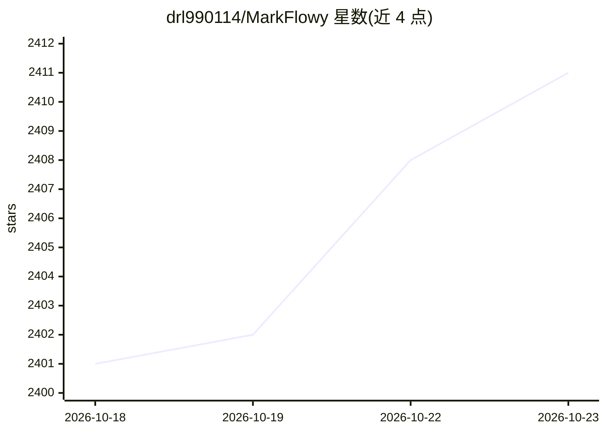

# drl990114/MarkFlowy

⭐ 2,411 · TypeScript · AGPL-3.0 · 推送 2026-10-22 · [GitHub](https://github.com/drl990114/MarkFlowy) · [官网](https://www.markflowy.cc) · 个人维护 · 中文 README

**本地优先的跨平台 Markdown 编辑器，可选接入 AI**

面向 macOS/Windows/Linux 的本地优先 Markdown 编辑器，支持可视化编辑、Markdown 源码与阅读模式切换，处理表格、任务列表、代码、数学公式、Mermaid 图与代码片段，提供文件树工作区、标签页、分栏、书签、大纲、快速打开、本地历史与草稿恢复。AI 为可选功能：聊天、摘要、翻译与内置 Copilot 助手，可配置 OpenAI 兼容服务、DeepSeek、Google 或 Ollama（本地推理需本地 Ollama 端点与模型）。本地编辑无需账号或 AI 提供商。

## 筛选速览

| 维度 | 判定 | 备注 |
|---|---|---|
| AI 角色 | `ai-enhanced` | 去掉 AI 部分产品仍成立 |
| 许可风险 | `viral` | AGPL-3.0 |
| 部署形态 | `desktop` | 安装包/桌面程序 |
| 模型依赖 | local-ok | 支持本地模型 |
| 硬件要求 | — | 无带数字的原话,不猜 |
| 安装摩擦 | `low` | 无编译、无系统依赖或容器化 |
| 成熟度 | — | 结构信号不足 |

## 能力要点

- 可视化/源码/阅读三种编辑模式与大文档性能优化
- 本地优先：无需账号即可编辑，本地历史与草稿恢复
- 可选 AI：聊天、摘要、翻译、Copilot，支持 DeepSeek/Ollama 等提供商
- 导出 HTML/图片/PDF，配合 Pandoc 可导出 DOCX/ODT/EPUB

## 适用场景

- 跨平台撰写与组织 Markdown 笔记和文档
- 在写作中按需使用 AI 聊天、翻译或 Copilot 辅助
- 用大纲、快速打开和工作区搜索管理大量文档

## 场景标签

`知识库管理` `AI 写作` · 领域:内容生成

## 证据(README 行号)

> L25: MarkFlowy is a local-first Markdown editor for **macOS, Windows, and Linux**. Write visually or in source, organize
> L38: - **Use AI on your terms.** Chat, summarize, translate, or enable Copilot with your configured provider: OpenAI-com

## 星数曲线

2026-10-18 2,401 → 2026-10-23 2,411（+10）

---
*卡片 v1 · prompt 1.4 · 生成 2026-10-21 · 置信度 high · 依据 README sha `07337c874a6d` · [字段定义](../../DATASET.md)*
