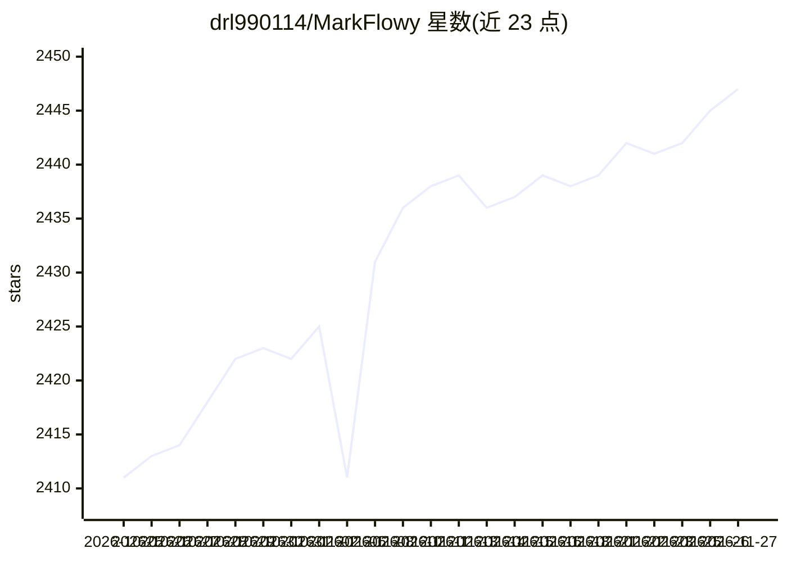

# drl990114/MarkFlowy

⭐ 2,447 · TypeScript · AGPL-3.0 · 推送 2026-11-24 · [GitHub](https://github.com/drl990114/MarkFlowy) · [官网](https://www.markflowy.cc) · 个人维护 · 中文 README

**本地优先的 Markdown/通用文本编辑器，可选接入 AI**

基于 Tauri 与 Web 前端构建的跨平台桌面应用，支持所见即所得、Markdown 源码与阅读三种模式，覆盖表格、任务列表、数学公式、Mermaid 图、代码片段、本地历史、主题定制与工作区搜索。AI 为可选功能：用户自行配置 OpenAI 兼容服务、DeepSeek、Google 或本地 Ollama 后端后可用聊天、摘要、翻译与 Copilot；不配置 AI 也可完整使用本地编辑功能。通过 GitHub Releases 安装包分发，Linux 提供 Flatpak 与安装脚本。

## 筛选速览

| 维度 | 判定 | 备注 |
|---|---|---|
| AI 角色 | `ai-enhanced` | 去掉 AI 部分产品仍成立 |
| 许可风险 | `viral` | AGPL-3.0 |
| 部署形态 | `desktop` | 安装包/桌面程序 |
| 模型依赖 | local-ok | 支持本地模型 |
| 硬件要求 | — | 无带数字的原话,不猜 |
| 安装摩擦 | `low` | 无编译、无系统依赖或容器化 |
| 成熟度 | — | 结构信号不足 |

## 能力要点

- 所见即所得/Markdown 源码/阅读三种编辑模式
- 可选 AI 功能：聊天、摘要、翻译、Copilot，支持本地 Ollama 端点
- 本地历史对比与草稿恢复
- 导出 HTML/图片/PDF，装 Pandoc 后支持 DOCX/ODT/EPUB

## 适用场景

- 在本地文件夹中组织和写作 Markdown 笔记
- 配置 DeepSeek 或 Ollama 后在编辑器内对话、翻译、摘要
- 需要大型 Markdown 文档流畅编辑的场景
- 离线环境下的纯本地写作（无账号无 AI）

## 场景标签

`知识库管理` · 领域:知识与检索

## 证据(README 行号)

> L25: MarkFlowy is a local-first Markdown editor for **macOS, Windows, and Linux**. Write visually or in source, organize
> L38: - **Use AI on your terms.** Chat, summarize, translate, or enable Copilot with your configured provider: OpenAI-com
> L41: Cloud AI and remote endpoints receive the context sent to them. Local inference requires a local Ollama endpoint **

## 星数曲线

2026-10-25 2,411 → 2026-11-27 2,447（+36）

---
*卡片 v1 · prompt 1.4 · 生成 2026-11-23 · 置信度 high · 依据 README sha `4249cb0e6b81` · [字段定义](../../DATASET.md)*
