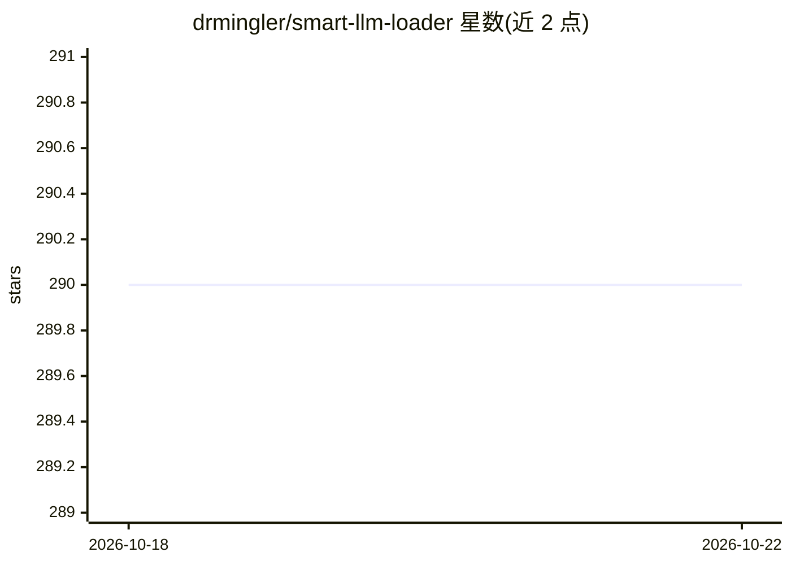

# drmingler/smart-llm-loader

⭐ 290 · Python · MIT · 推送 2026-08-03 · [GitHub](https://github.com/drmingler/smart-llm-loader) · 个人维护

**把各类文档转为 LLM 可用 chunk 的 Python 文档处理库**

Python 包，将 PDF 等文档转换为 markdown 并切分为面向 LLM 的 chunk：内置 OCR 处理扫描件与图片，支持 context-aware 与按页等切分策略，支持自定义 prompt 与切分逻辑。通过 litellm 调用多模态模型，可使用 litellm 支持的任意参数与模型；README 提供与 LangChain、LlamaIndex 的集成，并给出与 PyMuPDF 提取效果的对比示例。运行需先安装 Poppler 系统依赖（apt/brew/Windows 手动配置 PATH），包本体经 pip 或 Poetry 安装。

## 筛选速览

| 维度 | 判定 | 备注 |
|---|---|---|
| AI 角色 | `ai-ecosystem` | LLM/agent 周边工具 |
| 许可风险 | `permissive` | MIT |
| 部署形态 | `library` | 以包/库形式分发 |
| 模型依赖 | — | README 未给出锁定关系 |
| 硬件要求 | — | 无带数字的原话,不猜 |
| 安装摩擦 | `low` | 无编译、无系统依赖或容器化 |
| 成熟度 | — | 结构信号不足 |

## 能力要点

- 文档转 markdown，内置 OCR 处理扫描件与图片
- 支持 context-aware 与 page-based 切分策略及自定义切分
- 经 litellm 调用多模态模型，litellm 参数可用
- 提供 LangChain / LlamaIndex 集成

## 适用场景

- RAG 系统构建前的文档预处理与切分
- 扫描版 PDF 或图片文档的 OCR 与结构化提取
- 文档问答系统准备 LLM 可摄取的 chunk 数据

## 场景标签

 · 领域:LLM 基础设施/文档预处理

## 证据(README 行号)

> L3: smart-llm-loader is a lightweight yet powerful Python package that transforms any document into LLM-ready chunks. It
> L60: smart-llm-loader package uses litellm to call the LLM so any arguments supported by litellm can be used. You can fi
> L72: class SmartLLMLoader(BaseLoader):

## 星数曲线

2026-10-18 290 → 2026-10-22 290（+0）

---
*卡片 v1 · prompt 1.4 · 生成 2026-10-22 · 置信度 high · 依据 README sha `3db99b0c4daa` · [字段定义](../../DATASET.md)*
