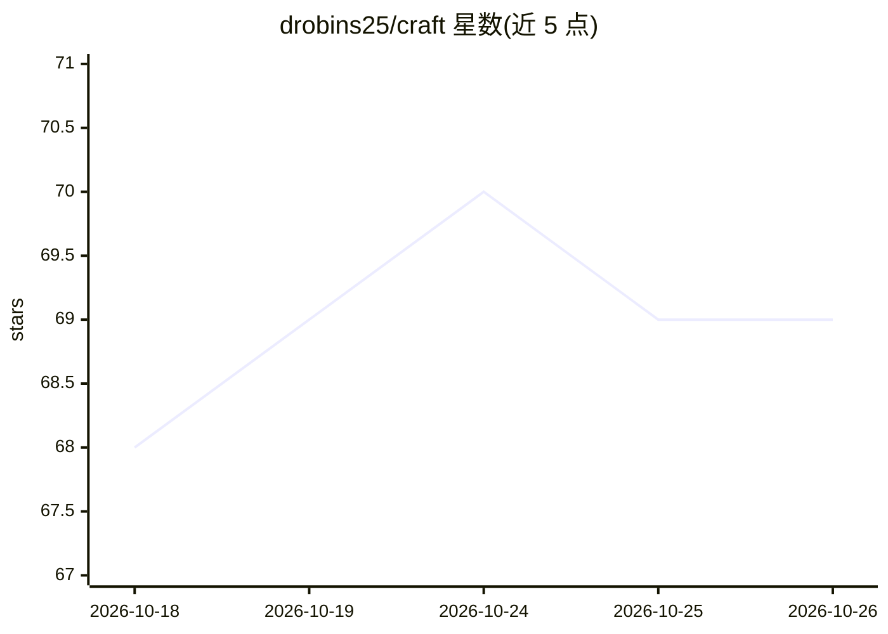

# drobins25/craft

⭐ 69 · Shell · MIT · 推送 2026-10-24 · [GitHub](https://github.com/drobins25/craft) · [官网](https://darinbuilds.com/projects/craft-platform) · 个人维护

**Claude Code 插件：受控写入门禁+品味记忆的开发工作流框架**

面向 Claude Code 用户的插件：默认将代码库设为只读，所有修改须经 Write Gate（planned story / adhoc tweak / mockup / annotate 等通道）落地；本地记录项目历史、设计 tokens（tokens.yaml）与决策，用于后续故事与校验器复用。提供可视化 Mockup 漏斗（三方案 HTML 实时预览、口头收敛）、页面标注（annotate）、A/B/C/D 面板（dial）、笔记本捕获与项目 dashboard。通过 claude plugin 命令安装，另含只读 guide 问答 agent 与 /craft:become 生成可移植 agent。

## 筛选速览

| 维度 | 判定 | 备注 |
|---|---|---|
| AI 角色 | `ai-ecosystem` | LLM/agent 周边工具 |
| 许可风险 | `permissive` | MIT |
| 部署形态 | `library` | 以包/库形式分发 |
| 模型依赖 | locked-api |  |
| 硬件要求 | — | 无带数字的原话,不猜 |
| 安装摩擦 | `low` | 无编译、无系统依赖或容器化 |
| 成熟度 | — | 结构信号不足 |

## 能力要点

- 默认只读代码库，写入需经批准的 Write Gate 通道
- Mockup/annotate/dial 三种在浏览器页面上实时收敛设计的命令
- 设计决策落入 tokens.yaml 并带来源，供后续故事与校验器执行
- /craft:become 将工具/角色研究成可移植 agent；笔记本记录品味并主动扩散

## 适用场景

- 在 Claude Code 中以受控门禁方式推进开发，避免意外写入
- 对着实际页面用评论和点击迭代 UI 设计而非文字描述
- 沉淀项目决策与设计偏好，跨功能复用

## 场景标签

`编码 Agent` `Agent 记忆` · 领域:Agent 开发

## 证据(README 行号)

> L25: A Claude Code plugin that acts as an intelligent harness for your development workflow: your codebase is read-only 
> L31: ```

## 星数曲线



2026-10-18 68 → 2026-10-26 69（+1）


---
*卡片 v1 · prompt 1.4 · 生成 2026-10-24 · 置信度 mid · 依据 README sha `a524323e80a8` · [字段定义](../../DATASET.md)*
