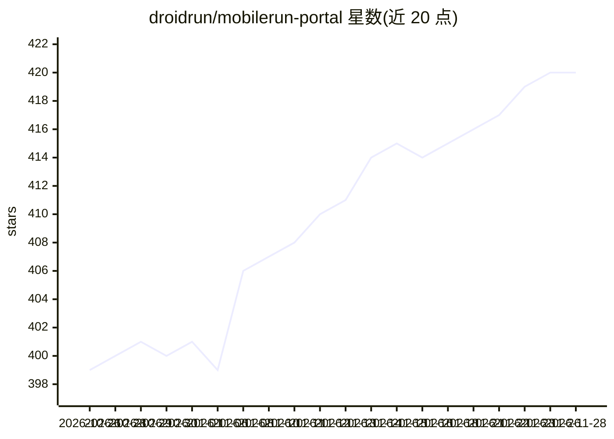

# droidrun/mobilerun-portal

⭐ 420 · Kotlin · NOASSERTION · 推送 2026-11-24 · [GitHub](https://github.com/droidrun/mobilerun-portal) · [官网](https://mobilerun.ai/framework) · 组织维护

**供 mobilerun 框架控制 Android 设备的无障碍服务端口应用**

Mobilerun Portal 是一个 Android 无障碍服务应用，为屏幕上的可点击、可勾选、可编辑、可滚动、可聚焦 UI 元素提供实时高亮叠加层与数据采集，作为 mobilerun 移动自动化框架的 Android 端配套应用。它提供三种本地控制接口（HTTP socket 服务器、WebSocket JSON-RPC、ContentProvider）、反向 WebSocket 云端控制、WebRTC 屏幕流、URL 安装 APK 与通知事件流。需要 Android 8.0+（API 26），文件操作要求 Android 11+，通过 GitHub Actions 自动构建并发布 APK。

## 筛选速览

| 维度 | 判定 | 备注 |
|---|---|---|
| AI 角色 | `ai-ecosystem` | LLM/agent 周边工具 |
| 许可风险 | `none` | NOASSERTION |
| 部署形态 | `None` |  |
| 模型依赖 | — | README 未给出锁定关系 |
| 硬件要求 | — | 无带数字的原话,不猜 |
| 安装摩擦 | `low` | 无编译、无系统依赖或容器化 |
| 成熟度 | — | 结构信号不足 |

## 能力要点

- 三种本地控制 API：HTTP（8080）、WebSocket（8081）、ADB ContentProvider
- 反向 WebSocket 连接支持云端控制（供 Mobilerun Cloud 使用）
- WebRTC 屏幕流与通知事件流推送
- 无障碍模式下 UI 树提取、手势、截图；另提供无无障碍的本地托管模式

## 适用场景

- 用自然语言命令自动化操作 Android 设备
- UI 测试与无障碍可用性评估
- 通过 ADB 或 WebSocket 脚本批量控制手机界面

## 场景标签

`GUI 自动化` · 领域:效率与自动化

## 证据(README 行号)

> L10: Mobilerun Portal is an Android accessibility service that provides real-time visual feedback and data collection fo
> L15: - Local control APIs (HTTP socket server, WebSocket JSON-RPC, and ContentProvider)
> L16: - Reverse WebSocket connection for cloud control

## 星数曲线

2026-10-26 399 → 2026-11-28 420（+21）

---
*卡片 v1 · prompt 1.4 · 生成 2026-11-25 · 置信度 high · 依据 README sha `58deb4258744` · [字段定义](../../DATASET.md)*
