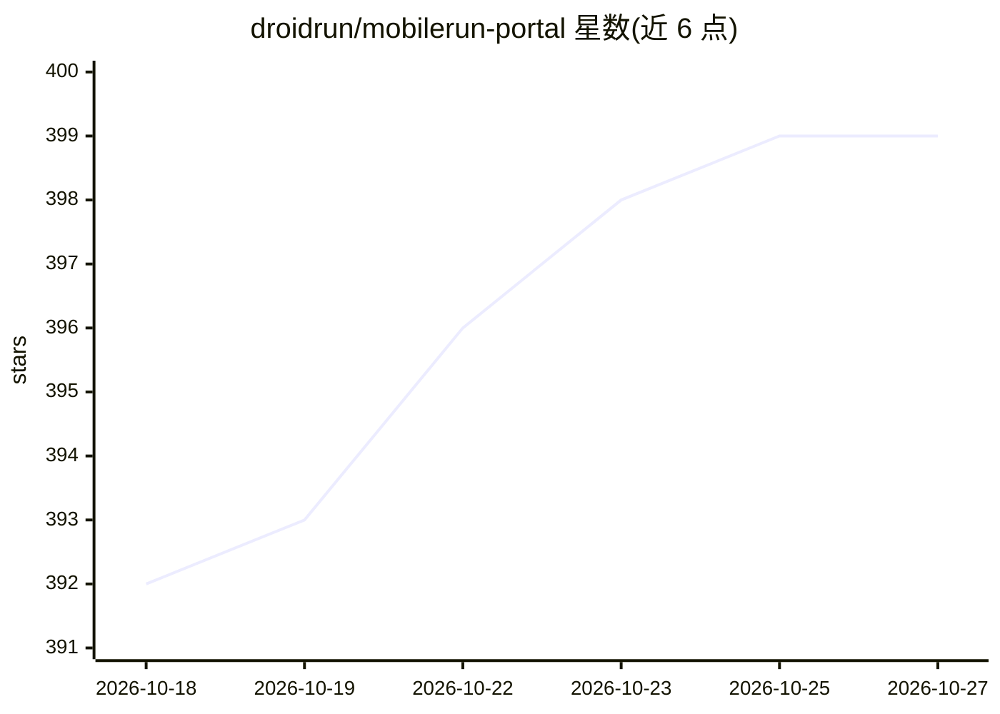

# droidrun/mobilerun-portal

⭐ 399 · Kotlin · NOASSERTION · 推送 2026-10-26 · [GitHub](https://github.com/droidrun/mobilerun-portal) · [官网](https://mobilerun.ai/framework) · 组织维护

**mobilerun 框架的 Android 配套应用：暴露 UI 控制与数据采集接口**

基于 Android 无障碍服务的配套应用，为 mobilerun 自然语言移动自动化框架提供设备侧能力：交互式 overlay 高亮可点击/可滚动等 UI 元素，暴露三种本地接口（HTTP、WebSocket JSON-RPC、ContentProvider/ADB），支持反向 WebSocket 云端控制、WebRTC 屏幕推流、APK 安装与通知事件流。面向做移动 UI 测试、自动化开发与无障碍评估的开发者。最低 API 26，文件操作需 Android 11+，Kotlin 编写，CI 自动构建签名 APK。

## 筛选速览

| 维度 | 判定 | 备注 |
|---|---|---|
| AI 角色 | `ai-ecosystem` | LLM/agent 周边工具 |
| 许可风险 | `none` | NOASSERTION |
| 部署形态 | `None` |  |
| 模型依赖 | — | README 未给出锁定关系 |
| 硬件要求 | — | 无带数字的原话,不猜 |
| 安装摩擦 | `low` | 无编译、无系统依赖或容器化 |
| 成熟度 | — | 结构信号不足 |

## 能力要点

- 三种本地控制接口：HTTP(8080)、WebSocket JSON-RPC(8081)、ContentProvider/ADB
- 反向 WebSocket 云端控制与 WebRTC 屏幕推流
- overlay 高亮可交互 UI 元素，用于测试与自动化开发
- 通过 ADB ContentProvider 提供 JSON 格式 UI 元素数据

## 适用场景

- 为移动自动化 agent 提供设备侧控制与数据接口
- 开发移动 UI 自动化测试，可视化可交互元素
- 云端远程控制真机并串流屏幕画面

## 场景标签

`GUI 自动化` · 领域:效率与自动化

## 证据(README 行号)

> L10: Mobilerun Portal is an Android accessibility service that provides real-time visual feedback and data collection fo
> L15: - Local control APIs (HTTP socket server, WebSocket JSON-RPC, and ContentProvider)

## 星数曲线

2026-10-18 392 → 2026-10-27 399（+7）

---
*卡片 v1 · prompt 1.4 · 生成 2026-10-21 · 置信度 high · 依据 README sha `d8b963814779` · [字段定义](../../DATASET.md)*
