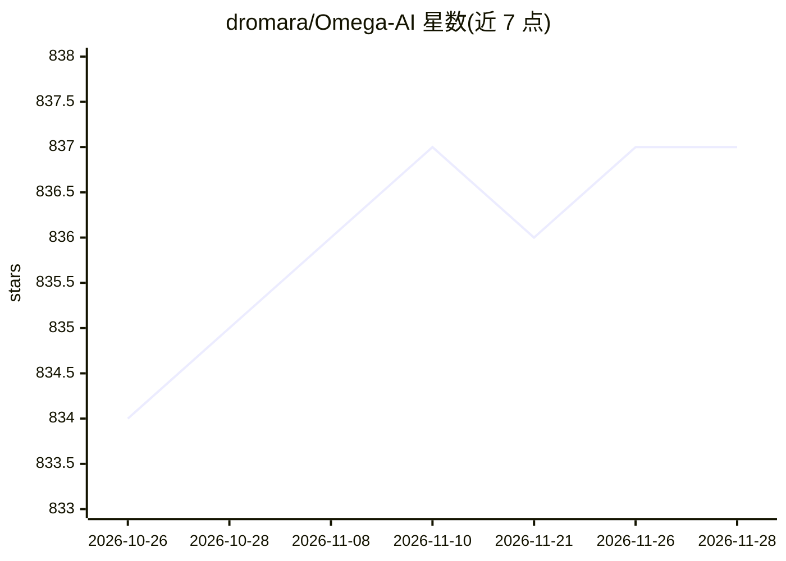

# dromara/Omega-AI

⭐ 837 · Java · Apache-2.0 · 推送 2026-11-26 · [GitHub](https://github.com/dromara/Omega-AI) · 组织维护 · 中文 README

**给 Java 开发者的纯 Java 深度学习框架：搭建网络、训练与推理**

基于 Java 实现的深度学习框架，提供自动微分、多线程与 CUDA/cuDNN GPU 加速的引擎，除 CUDA 相关依赖外不使用第三方 API。内置全连接/卷积/循环/注意力等网络层、多种优化器与损失函数，README 展示了 yolo 目标识别、GAN、GPT2/llama 聊天与医疗问答、diffusion/stable diffusion 文生图等模型构建，并通过 Maven 引入 omega-engine 包使用。训练大参数模型需调整 JVM 内存；GPU 版需按 CUDA 版本匹配 jcuda 依赖。

## 筛选速览

| 维度 | 判定 | 备注 |
|---|---|---|
| AI 角色 | `ai-native` | 本体是模型或模型工具 |
| 许可风险 | `permissive` | Apache-2.0 |
| 部署形态 | `None` |  |
| 模型依赖 | — | README 未给出锁定关系 |
| 硬件要求 | — | 无带数字的原话,不猜 |
| 安装摩擦 | `medium` | 含编译或系统依赖之一 |
| 成熟度 | — | 结构信号不足 |

## 能力要点

- 纯 Java 实现引擎，除 CUDA/cuDNN 依赖外不使用第三方 API
- 支持 BP/CNN/RNN/yolo/transformer/gpt/llama/diffusion/stable diffusion 等模型构建
- 提供 18 类网络层、6 种优化器、多种损失函数与学习率更新器
- 支持多 GPU 训练与 CUDA/cuDNN 加速

## 适用场景

- 在 Java 项目中训练或推理神经网络模型
- 实现 yolo 目标识别与追踪应用
- 微调 GPT2/llama 模型做聊天机器人或医疗问答
- 训练 diffusion/stable diffusion 做文生图

## 场景标签

`聊天机器人` `图像生成` `目标检测` `微调` · 领域:对话与助手

## 证据(README 行号)

> L10: Omega-AI：基于java打造的深度学习框架，帮助你快速搭建神经网络，实现训练或测试模型，支持多GPU训练。框架目前支持BP神经网络、卷积神经网络、循环神经网络、vgg16、resnet、yolo、lstm、transform
> L289: ## 功能介绍

## 星数曲线

2026-10-26 834 → 2026-11-28 837（+3）

---
*卡片 v1 · prompt 1.4 · 生成 2026-11-27 · 置信度 high · 依据 README sha `bbd97900e5be` · [字段定义](../../DATASET.md)*
