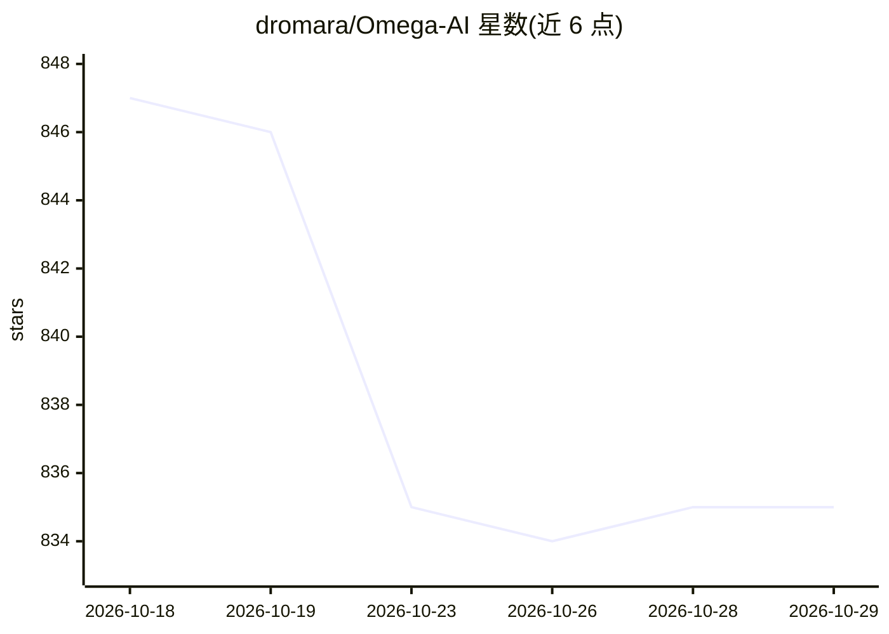

# dromara/Omega-AI

⭐ 835 · Java · Apache-2.0 · 推送 2026-10-17 · [GitHub](https://github.com/dromara/Omega-AI) · 个人维护 · 中文 README

**Java 深度学习框架：从零搭建神经网络训练与推理**

纯 Java 实现的深度学习框架，提供自动微分、多线程与 CUDA/cuDNN GPU 加速，支持 BP、CNN、RNN、LSTM、Transformer、GPT、Llama、Diffusion、YOLO 等模型的构建与训练。面向 Java 开发者学习算法原理与接触 AI 领域。除 CUDA/cuDNN 相关依赖外不使用第三方 API，以 Maven 引擎包形式引入，自带 iris/mnist/cifar_10 数据集与多组示例代码；GPU 版本需安装与本机匹配的 CUDA，训练大模型需调整 JVM 内存参数。

## 筛选速览

| 维度 | 判定 | 备注 |
|---|---|---|
| AI 角色 | `ai-ecosystem` | LLM/agent 周边工具 |
| 许可风险 | `permissive` | Apache-2.0 |
| 部署形态 | `None` |  |
| 模型依赖 | — | README 未给出锁定关系 |
| 硬件要求 | — | 无带数字的原话,不猜 |
| 安装摩擦 | `medium` | 含编译或系统依赖之一 |
| 成熟度 | — | 结构信号不足 |

## 能力要点

- 纯 Java 引擎，除 CUDA/cuDNN 外不依赖第三方包
- 支持 CUDA/cuDNN 两种 GPU 加速与多 GPU 训练
- 覆盖 GPT/Llama/Transformer/Diffusion/YOLO 等模型构建
- 提供网络层、优化器、损失函数、学习率更新器等组件与示例代码

## 适用场景

- Java 开发者在本语言内训练神经网络模型
- 学习深度学习算法与模型实现原理
- 做目标检测（口罩/安全帽/商品）、文生图等演示项目

## 场景标签

`模型训练` · 领域:训练与推理

## 证据(README 行号)

> L10: Omega-AI：基于java打造的深度学习框架，帮助你快速搭建神经网络，实现训练或测试模型，支持多GPU训练。框架目前支持BP神经网络、卷积神经网络、循环神经网络、vgg16、resnet、yolo、lstm、transform
> L8: 从2016年开始利用空余时间研究深度学习的方面，由于工作的原因，最熟悉的编程语言就是java，所以框架的编程语言自然而然就使用了java。自己打造框架的初衷就是为了更加深入了解各个算法、模型、实现的原理和思路，同时让java开发者更

## 星数曲线

2026-10-18 847 → 2026-10-29 835（-12）

---
*卡片 v1 · prompt 1.4 · 生成 2026-10-21 · 置信度 high · 依据 README sha `76e58942b0e7` · [字段定义](../../DATASET.md)*
