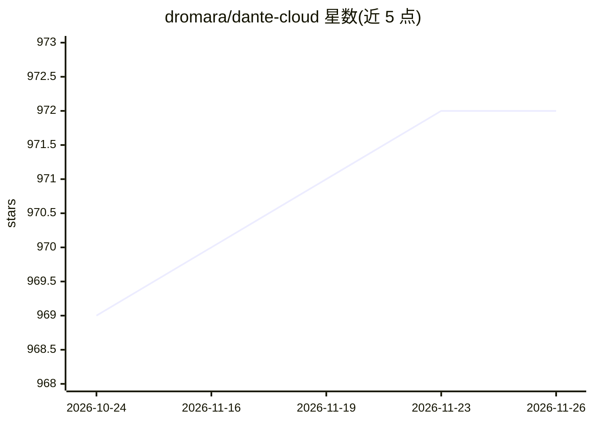

# dromara/dante-cloud

⭐ 972 · Java · Apache-2.0 · 推送 2026-11-25 · [GitHub](https://github.com/dromara/dante-cloud) · [官网](https://www.herodotus.cn) · 个人维护 · 中文 README

**企业级云原生微服务基座，一套代码切换微服务/单体**

基于 Spring Boot/Cloud/Alibaba 生态的企业级应用基座，提供微服务与单体两种运行模式且共享同一套代码，支持按需切换。采用 DDD 设计与模块化组件体系（Dante Engine 组件库），内置多租户、IoT 设备认证、国密数字信封加密、等保三级安全体系；集成 Spring AI，定位为面向 AI Agent 开发的智能基座。运行依赖 JDK 25（master 分支），含 Docker 构建上下文与前端 UI 子工程，文档与升级指南在 herodotus.cn。

## 筛选速览

| 维度 | 判定 | 备注 |
|---|---|---|
| AI 角色 | `ai-ecosystem` | LLM/agent 周边工具 |
| 许可风险 | `permissive` | Apache-2.0 |
| 部署形态 | `self-host` | docker 或自建部署 |
| 模型依赖 | — | README 未给出锁定关系 |
| 硬件要求 | — | 无带数字的原话,不猜 |
| 安装摩擦 | `low` | 无编译、无系统依赖或容器化 |
| 成熟度 | — | 结构信号不足 |

## 能力要点

- 一套代码可在微服务与单体架构间灵活切换
- 覆盖 IoT 设备认证、国密数字信封加密、等保三级安全体系
- 提供多租户解决方案与 Dante Engine 组件库
- 集成 Spring AI，面向 AI Agent 开发

## 适用场景

- 从单体起步、后续平滑迁移到微服务的企业项目
- 需要多租户与国密合规安全体系的后端基座
- 构建面向 AI Agent 的企业级智能应用底座

## 场景标签

 · 领域:企业级应用开发/云原生基础设施

## 证据(README 行号)

> L35: **Dante Cloud** 国内首个支持阻塞式和响应式服务并行的、开箱即用的企业级云原生微服务基座和面向 AI Agent 开发的智能基座。是采用**领域驱动模型(DDD)**设计思想，以「**高质量代码、低安全漏洞**」为核
> L9:  Spring AI 2.0.3

## 星数曲线

2026-10-24 969 → 2026-11-26 972（+3）

---
*卡片 v1 · prompt 1.4 · 生成 2026-11-24 · 置信度 mid · 依据 README sha `c29221629e39` · [字段定义](../../DATASET.md)*
