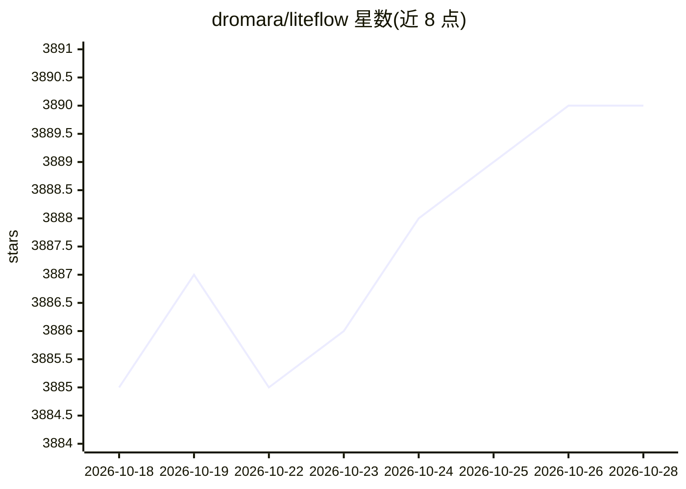

# dromara/liteflow

⭐ 3,890 · Java · Apache-2.0 · 推送 2026-09-21 · [GitHub](https://github.com/dromara/liteflow) · 组织维护 · 中文 README

**面向 Java 开发者的组件编排规则引擎，可将 AI Agent 编排进业务规则**

LiteFlow 是基于 Java 的轻量级规则/编排引擎：业务逻辑统一抽象为组件，通过 XML/JSON/YML 规则文件驱动流程，支持同步异步混排、规则嵌套、热刷新部署、多种脚本语言节点（Groovy/Java/Kotlin/JavaScript/Python/Lua 等）以及从数据库、Nacos、Etcd、Zookeeper、Apollo、Redis 加载规则。自 v2.16.0 起，随附 liteflow-agent 模块，可将完整 Agent（Reasoning+Acting）封装为标准组件，接入 OpenAI、Claude、DeepSeek、Qwen、Kimi、GLM 等平台，Agent 节点与普通业务节点使用同一套编排算子。需要 JDK 运行环境。

## 筛选速览

| 维度 | 判定 | 备注 |
|---|---|---|
| AI 角色 | `ai-ecosystem` | LLM/agent 周边工具 |
| 许可风险 | `permissive` | Apache-2.0 |
| 部署形态 | `None` |  |
| 模型依赖 | — | README 未给出锁定关系 |
| 硬件要求 | — | 无带数字的原话,不猜 |
| 安装摩擦 | `medium` | 含编译或系统依赖之一 |
| 成熟度 | — | 结构信号不足 |

## 能力要点

- 自 v2.16.0 提供 liteflow-agent 模块，AI Agent 作为一等公民可直接编排进规则
- 规则支持 XML/JSON/YML 三种写法，可从数据库、Nacos、Etcd、Zookeeper、Apollo、Redis 加载
- 支持热刷新部署，规则变更无需重启应用
- 8 种脚本语言节点可调用 Java 方法与发起 RPC

## 适用场景

- 复杂系统中将业务逻辑组件化并解耦编排
- 把 AI Agent 节点嵌入既有业务流程中统一调度
- 通过规则热刷新在不重启应用的情况下调整流程

## 场景标签

`工作流自动化` · 领域:效率与自动化

## 证据(README 行号)

> L14: Starting from v2.16.0, LiteFlow even turns an AI Agent into a first-class citizen that can be orchestrated directly
> L35: * **AI Agent orchestration:** Wraps a full Agent into a standard LiteFlow component, so AI can be orchestrated dire
> L61: Starting from v2.16.0, LiteFlow ships its own AI Agent module, `liteflow-agent`.

## 星数曲线

2026-10-18 3,885 → 2026-10-28 3,890（+5）

---
*卡片 v1 · prompt 1.4 · 生成 2026-10-20 · 置信度 high · 依据 README sha `8f235bfaacad` · [字段定义](../../DATASET.md)*
