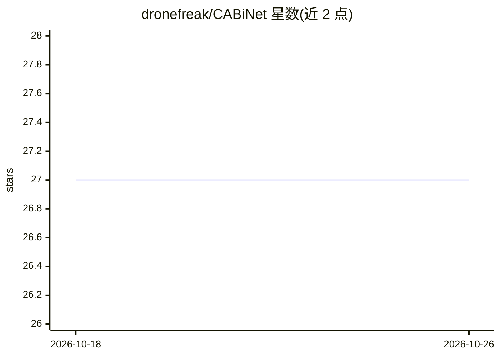

# dronefreak/CABiNet

⭐ 27 · Python · Apache-2.0 · 推送 2026-09-02 · [GitHub](https://github.com/dronefreak/CABiNet) · [官网](https://huggingface.co/spaces/dronefreak/uavid-aerial-segmentation) · 组织维护

**低延迟实时语义分割 CNN，面向自主系统与航拍影像**

ICRA 2021 论文官方仓库：CABiNet 双分支 CNN（空间分支+上下文分支，MobileNetV3 骨干，FFM 融合），用于实时语义分割，面向自主系统与航拍影像。仓库提供训练/评估/性能剖析脚本，并附统一管线在 UAVid、AeroScapes、VDD 三个航拍数据集上与 Ultralytics YOLO26 semantic 任务的基准对比及 Model Zoo 权重。要求 Python 3.10+ 与 PyTorch，推荐 CUDA GPU；提供 Hugging Face Spaces 在线演示。Apache 2.0 许可，由特文特大学开发。

## 筛选速览

| 维度 | 判定 | 备注 |
|---|---|---|
| AI 角色 | `ai-native` | 本体是模型或模型工具 |
| 许可风险 | `permissive` | Apache-2.0 |
| 部署形态 | `None` |  |
| 模型依赖 | — | README 未给出锁定关系 |
| 硬件要求 | — | 无带数字的原话,不猜 |
| 安装摩擦 | `medium` | 含编译或系统依赖之一 |
| 成熟度 | — | 结构信号不足 |

## 能力要点

- 双分支架构：空间分支+上下文分支+特征融合模块（FFM），含深监督辅助头
- 统一管线下与 YOLO26-sem 在 UAVid/AeroScapes/VDD 三个航拍数据集的基准对比
- Model Zoo 提供 CABiNet 与 YOLO26-sem 各尺寸权重的 mIoU/Params/FLOPs 表
- Hugging Face Spaces 在线演示，可对自有航拍图像运行任意 checkpoint

## 适用场景

- 无人机/航拍影像的实时语义分割
- 自主系统的低延迟场景理解
- 复现论文结果或对比实时分割模型精度与延迟

## 场景标签

`目标检测` · 领域:感知与多模态

## 证据(README 行号)

> L10: CABiNet is a dual-branch CNN for real-time semantic segmentation — competitive accuracy at
> L207: Apache 2.0 — see LICENSE. Developed at the University of Twente, Faculty ITC.

## 星数曲线

2026-10-18 27 → 2026-10-26 27（+0）

---
*卡片 v1 · prompt 1.4 · 生成 2026-10-26 · 置信度 high · 依据 README sha `73646de2ce3f` · [字段定义](../../DATASET.md)*
