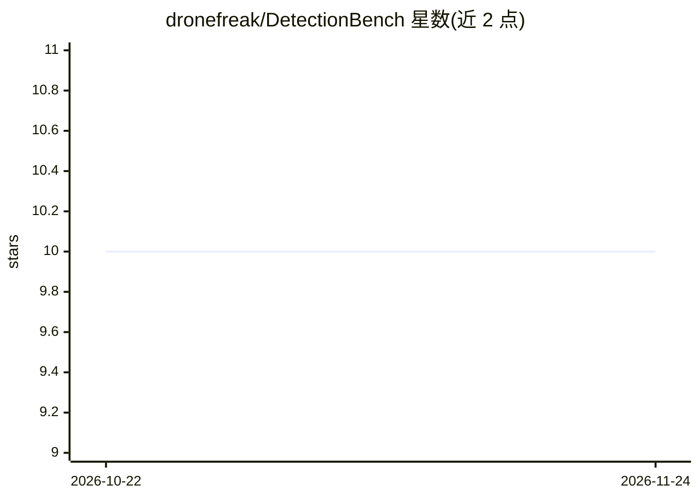

# dronefreak/DetectionBench

⭐ 10 · Python · Apache-2.0 · 推送 2026-11-23 · [GitHub](https://github.com/dronefreak/DetectionBench) · 个人维护

**面向非 COCO 检测数据集的标准化评测框架**

Hydra 驱动的目标检测基准框架：通过统一的数据集适配器、训练配方与评测协议，在 24 个真实场景检测数据集上训练与评测 YOLO、RT-DETR、RF-DETR 三族模型，并提供 CLI 完成 YOLO↔COCO 格式转换、数据统计报告、逐类指标与硬件性能剖析（延迟/FPS/显存/FLOPs）。面向需要在航空、海事、农业、文档等领域公平比较检测器的研究者与工程师。安装以 pip editable 方式提供，含多个可选 extras。

## 筛选速览

| 维度 | 判定 | 备注 |
|---|---|---|
| AI 角色 | `ai-native` | 本体是模型或模型工具 |
| 许可风险 | `permissive` | Apache-2.0 |
| 部署形态 | `library` | 以包/库形式分发 |
| 模型依赖 | — | README 未给出锁定关系 |
| 硬件要求 | — | 无带数字的原话,不猜 |
| 安装摩擦 | `low` | 无编译、无系统依赖或容器化 |
| 成熟度 | — | 结构信号不足 |

## 能力要点

- 单一 CLI 覆盖三族模型训练/评测/推理/基准，按模型名自动分发
- 24 个数据集适配器统一转为 COCO 布局，下游流程数据集无关
- 硬件剖析输出 latency/FPS/VRAM/参数量/FLOPs
- 发布 v1 各数据集排行榜及 Hugging Face 模型卡

## 适用场景

- 在 UAV、水下、低光等小众检测数据集上复现统一的训练评测流程
- 用相同配方横向对比 YOLO 与 DETR 类检测器
- 为部署前获取模型的延迟、FPS 与显存指标
- 为各数据集生成类别分布与框几何统计报告

## 场景标签

`模型评测` `目标检测` `模型训练` · 领域:评测与运维

## 证据(README 行号)

> L29: DetectionBench is a Hydra-driven framework for preparing those datasets, training models, evaluating performance, a
> L33: DetectionBench wraps two model families behind one CLI, trained and evaluated with identical recipes (same augmenta

## 星数曲线

2026-10-22 10 → 2026-11-24 10（+0）

---
*卡片 v1 · prompt 1.4 · 生成 2026-11-19 · 置信度 high · 依据 README sha `4869e7295f19` · [字段定义](../../DATASET.md)*
