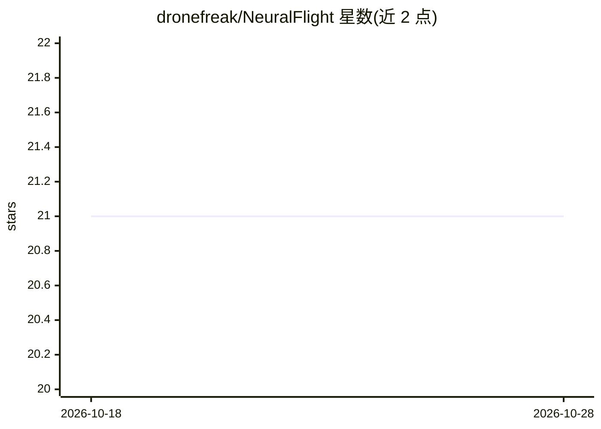

# dronefreak/NeuralFlight

⭐ 21 · Python · Apache-2.0 · 推送 2025-11-21 · [GitHub](https://github.com/dronefreak/NeuralFlight) · 个人维护

**用手势、头部动作或 EEG 运动想象控制无人机的框架**

提供三种控制模式控制一个基于 Pygame 的物理仿真无人机：用 Mediapipe Hands 跟踪手腕位置的手势控制、用 Mediapipe Face Mesh 估计头部姿态的免手控制、以及基于 PhysioNet 数据集训练带残差连接的 EEGNet 进行运动想象分类（17 通道，跨被试准确率 73%）。仅需摄像头与 Python 即可运行，面向 BCI 研究原型、教学、无障碍控制等场景；暂不支持真实无人机硬件（列为未来工作），且声明不适用于安全关键应用。

## 筛选速览

| 维度 | 判定 | 备注 |
|---|---|---|
| AI 角色 | `ai-native` | 本体是模型或模型工具 |
| 许可风险 | `permissive` | Apache-2.0 |
| 部署形态 | `library` | 以包/库形式分发 |
| 模型依赖 | — | README 未给出锁定关系 |
| 硬件要求 | — | 无带数字的原话,不猜 |
| 安装摩擦 | `medium` | 含编译或系统依赖之一 |
| 成熟度 | — | 结构信号不足 |

## 能力要点

- 三种控制模式：手势、头部姿态、EEG 运动想象
- 带残差连接的 EEGNet，17 通道跨被试 73% 准确率
- 基于 Pygame 的物理仿真无人机，无需实体硬件即可测试
- Mediapipe Hands/Face Mesh 实时视觉跟踪（60 FPS 推理）

## 适用场景

- 快速搭建 BCI 算法研究原型
- 教学演示机器学习、信号处理与机器人控制
- 为运动障碍用户提供替代控制方式的验证
- 黑客松快速做 BCI/手势演示

## 场景标签

 · 领域:脑机接口/机器人控制

## 证据(README 行号)

> L90: **How it works:** Uses the PhysioNet Motor Movement/Imagery Dataset to train an EEGNet model with residual connecti
> L97:  - **Motor Imagery**: Real EEG classification (research-grade, 73% accuracy)

## 星数曲线

2026-10-18 21 → 2026-10-28 21（+0）

---
*卡片 v1 · prompt 1.4 · 生成 2026-10-28 · 置信度 high · 依据 README sha `a6e71e851a5a` · [字段定义](../../DATASET.md)*
