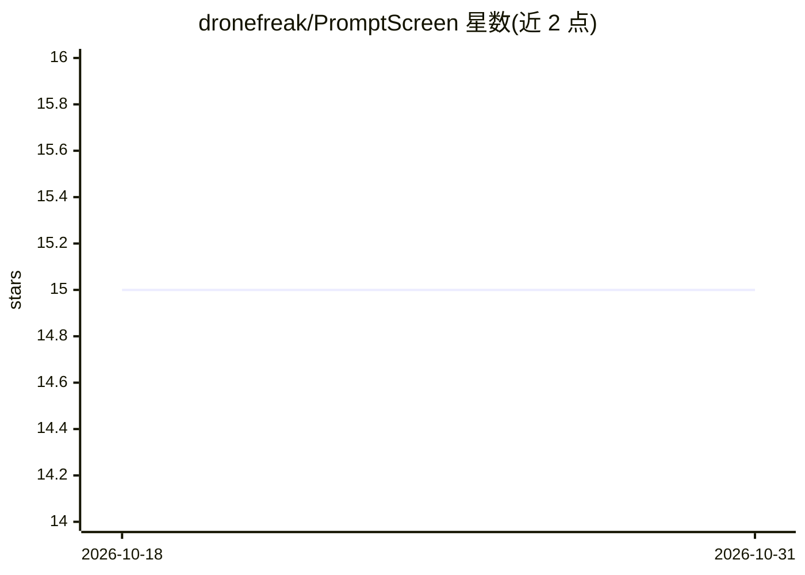

# dronefreak/PromptScreen

⭐ 15 · Python · Apache-2.0 · 推送 2026-08-12 · [GitHub](https://github.com/dronefreak/PromptScreen) · [官网](https://pypi.org/project/promptscreen/) · 个人维护

**检测 LLM 提示注入与越狱攻击的 Python 防护库**

面向生产环境的 LLM 输入安全防护 Python 库：提供 11 个防护组件，涵盖启发式规则、YARA 规则匹配、正则检测、Unicode 隐写、编码载荷、速率限制、SVM 分类器等，核心组件零额外依赖，单组件耗时标注在毫秒级；可选组件含向量库比对、双 ML 分类器集群与 ShieldGemma 2B 分类器。可通过 pip 安装，附带 CLI 链式扫描与 FastAPI 服务集成，API 默认无鉴权仅供本地/开发使用。vectordb 组件默认为空 Chroma 集合，需自备数据填充。

## 筛选速览

| 维度 | 判定 | 备注 |
|---|---|---|
| AI 角色 | `ai-ecosystem` | LLM/agent 周边工具 |
| 许可风险 | `permissive` | Apache-2.0 |
| 部署形态 | `library` | 以包/库形式分发 |
| 模型依赖 | — | README 未给出锁定关系 |
| 硬件要求 | — | 无带数字的原话,不猜 |
| 安装摩擦 | `low` | 无编译、无系统依赖或容器化 |
| 成熟度 | — | 结构信号不足 |

## 能力要点

- 11 个防护组件覆盖注入、越狱、隐写、编码载荷与自动探测
- 核心组件零额外依赖，多组件标注 <5 ms 延迟
- CLI 链式扫描与 FastAPI 服务集成，任一组件拦截即标记
- 可选 ShieldGemma 2B、SVM、ML 分类器集群等模型级防护

## 适用场景

- 在 LLM 应用管道中拦截提示注入与越狱输入
- 对 base64/hex/ROT13 等编码隐藏的注入载荷做检测
- 通过 CLI 对提示做多组件批量扫描
- 以 FastAPI 服务形式部署提示安全检查接口

## 场景标签

`网络安全` · 领域:学习与行业

## 证据(README 行号)

> L3: **A prompt injection and jailbreak detection system for LLMs**
> L11: PromptScreen is an open-source library that provides multiple defence layers against prompt injection attacks and j

## 星数曲线

2026-10-18 15 → 2026-10-31 15（+0）

---
*卡片 v1 · prompt 1.4 · 生成 2026-10-30 · 置信度 high · 依据 README sha `2688bc9ac347` · [字段定义](../../DATASET.md)*
