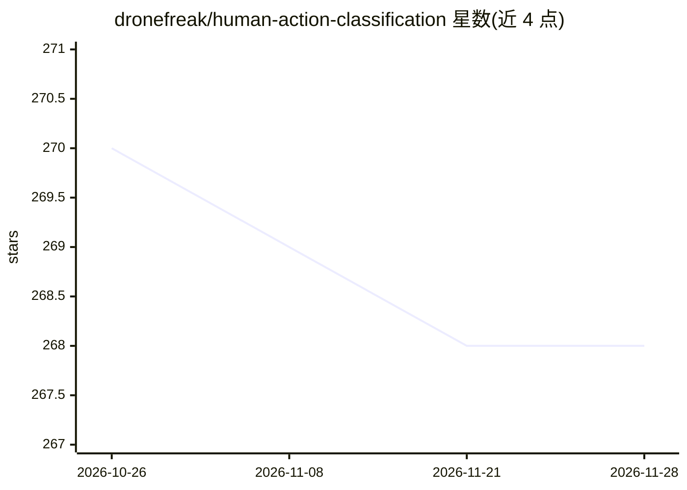

# dronefreak/human-action-classification

⭐ 268 · Python · Apache-2.0 · 推送 2026-11-22 · [GitHub](https://github.com/dronefreak/human-action-classification) · [官网](https://huggingface.co/dronefreak/mc3-18-ucf101) · 个人维护

**面向开发者的人体动作识别模型库与工具包**

提供图像与视频两类人体动作识别：单帧姿态感知分类（MediaPipe + timm）与视频时序 3D-CNN 分类（torchvision 视频模型），权重托管于 Hugging Face Hub 供下载。含模型 zoo（MC3-18、R3D-18、ResNet 系列、MobileNetV3）、Python 推理 API、CLI 与 Gradio 演示，并给出基于 UCF-101/Stanford40 的自训练脚本。视频模型仅在 split 1 上评估，Gradio 演示仅覆盖图像管线。

## 筛选速览

| 维度 | 判定 | 备注 |
|---|---|---|
| AI 角色 | `ai-native` | 本体是模型或模型工具 |
| 许可风险 | `permissive` | Apache-2.0 |
| 部署形态 | `library` | 以包/库形式分发 |
| 模型依赖 | — | README 未给出锁定关系 |
| 硬件要求 | — | 无带数字的原话,不猜 |
| 安装摩擦 | `low` | 无编译、无系统依赖或容器化 |
| 成熟度 | — | 结构信号不足 |

## 能力要点

- 视频 3D-CNN 模型（MC3-18/R3D-18）与图像 ResNet/MobileNetV3 模型 zoo，权重托管 Hugging Face Hub
- MediaPipe 姿态分类（坐/站/卧）与 CNN 预测融合的实时姿态识别
- 提供推理 API、hac-infer CLI、摄像头输入与 Gradio 网页演示
- 附带 UCF-101/Stanford40 数据划分与训练脚本（mixup/cutmix、标签平滑等选项）

## 适用场景

- 对图片或视频片段做人体动作分类推理
- 在 UCF-101/Stanford40 上训练自己的动作识别模型
- 用摄像头实时识别坐/站/卧姿态

## 场景标签

`目标检测` · 领域:感知与多模态

## 证据(README 行号)

> L8: Action recognition for both **images** and **videos**: pose-aware single-frame classification with MediaPipe + timm,
> L41: Also includes real-time pose classification (sitting/standing/lying) via MediaPipe, fused with the CNN prediction.

## 星数曲线

2026-10-26 270 → 2026-11-28 268（-2）

---
*卡片 v1 · prompt 1.4 · 生成 2026-11-25 · 置信度 high · 依据 README sha `6b7377929dcc` · [字段定义](../../DATASET.md)*
