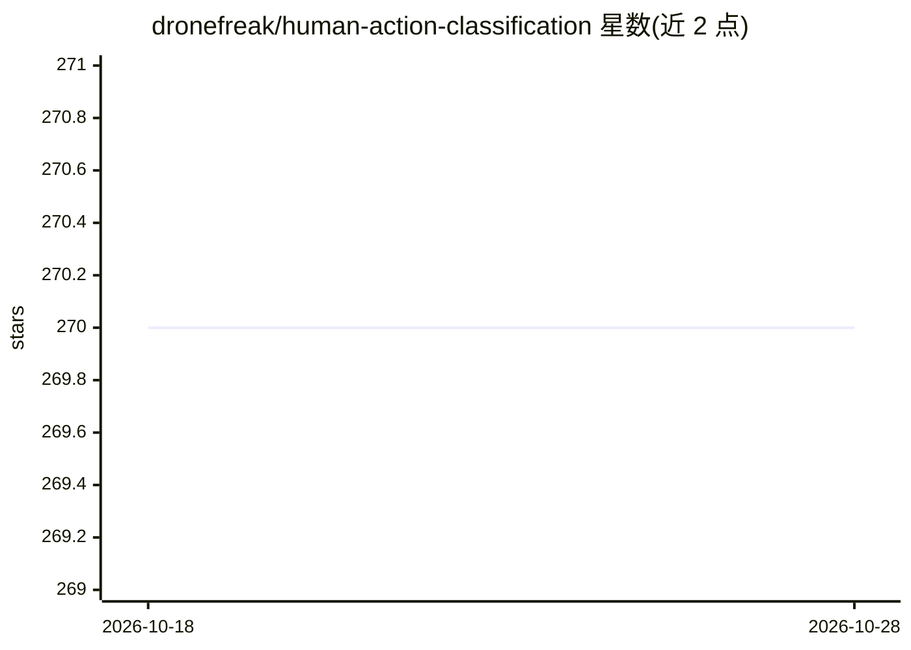

# dronefreak/human-action-classification

⭐ 270 · Python · Apache-2.0 · 推送 2026-09-14 · [GitHub](https://github.com/dronefreak/human-action-classification) · [官网](https://huggingface.co/dronefreak/mc3-18-ucf101) · 个人维护

**人体动作分类系统：图像姿态与视频 3D-CNN 双管线**

基于 PyTorch 的人体动作识别项目，提供两条管线：图像/单帧分类（Stanford40，ResNet/MobileNetV3 等 timm 架构）与视频时序分类（UCF-101/HMDB51，MC3-18、R3D-18 等 3D CNN）。图像管线通过 MediaPipe 做实时姿态分类（坐/站/躺）并与 CNN 预测融合。权重托管在 Hugging Face，提供 Python API、CLI（hac-infer）与 Gradio 演示（仅图像管线，暂无视频演示），并附训练脚本支持自训模型。

## 筛选速览

| 维度 | 判定 | 备注 |
|---|---|---|
| AI 角色 | `ai-native` | 本体是模型或模型工具 |
| 许可风险 | `permissive` | Apache-2.0 |
| 部署形态 | `library` | 以包/库形式分发 |
| 模型依赖 | — | README 未给出锁定关系 |
| 硬件要求 | — | 无带数字的原话,不猜 |
| 安装摩擦 | `medium` | 含编译或系统依赖之一 |
| 成熟度 | — | 结构信号不足 |

## 能力要点

- 视频管线基于 torchvision 3D CNN（MC3-18 UCF-101 达 87.05%）
- 图像管线基于 timm 多架构（ResNet50 Stanford40 达 88.5%）
- MediaPipe 实时姿态分类（坐/站/躺）与 CNN 预测融合
- 提供 Python API、CLI 与 Gradio 演示及训练脚本

## 适用场景

- 对图片或视频片段做人体动作分类
- 用摄像头做实时姿态（坐/站/躺）识别
- 在 UCF-101/Stanford40 上复现或训练自己的动作分类模型

## 场景标签

 · 领域:计算机视觉/动作识别

## 证据(README 行号)

> L8: Action recognition for both **images** and **videos**: pose-aware single-frame classification with MediaPipe + timm,
> L39: Also includes real-time pose classification (sitting/standing/lying) via MediaPipe, fused with the CNN prediction.

## 星数曲线

2026-10-18 270 → 2026-10-28 270（+0）

---
*卡片 v1 · prompt 1.4 · 生成 2026-10-22 · 置信度 high · 依据 README sha `65c5a421ef67` · [字段定义](../../DATASET.md)*
