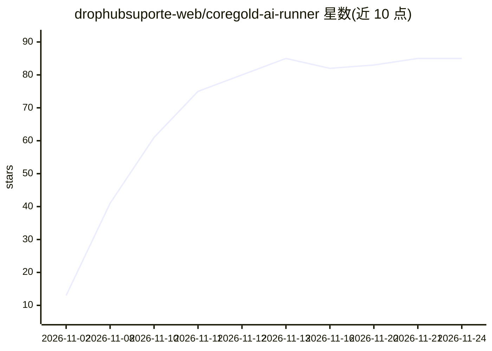

# drophubsuporte-web/coregold-ai-runner

⭐ 85 · 推送 2026-10-31 · [GitHub](https://github.com/drophubsuporte-web/coregold-ai-runner) · [官网](https://app.coregold.io/signup?invite_code=ADvlj9b) · 组织维护 · 中文 README

**CoreGold 虚拟卡服务的推广页：用于 AI 订阅支付**

仓库实为 CoreGold 虚拟信用卡服务的营销/引流页面，非可安装的软件项目：宣传用 USDT 充值生成海外 Visa/Mastercard 虚拟卡，用于支付 Cursor、Claude、OpenAI 等 AI 订阅，宣称带 AVS 英文账单、单卡限额、一键注销退余额。README 无任何代码、安装或运行说明，仅含注册入口链接与一串十六进制串。本质上是一个商业服务的广告落地页。

## 筛选速览

| 维度 | 判定 | 备注 |
|---|---|---|
| AI 角色 | `ai-enhanced` | 去掉 AI 部分产品仍成立 |
| 许可风险 | `none` | — |
| 部署形态 | `None` |  |
| 模型依赖 | — | README 未给出锁定关系 |
| 硬件要求 | — | 无带数字的原话,不猜 |
| 安装摩擦 | `low` | 无编译、无系统依赖或容器化 |
| 成熟度 | — | 结构信号不足 |

## 能力要点

- USDT 充值生成海外 Visa/Mastercard 虚拟卡
- 单卡设置消费限额用于订阅预算控制
- 后台一键注销卡片、余额回流母账户

## 适用场景

- 用虚拟卡支付海外 AI 工具订阅
- 为团队成员的多账号设置额度隔离

## 场景标签

 · 领域:支付服务/营销

## 证据(README 行号)

> L7: > 用 **CoreGold** 生成独立的海外 Visa / Mastercard 虚拟卡，直通高权重商业卡段，USDT 充值即开即用，一键搞定全部顶级 AI 订阅。
> L9: 👉 **立即进入 CoreGold AI 专用开卡后台**
> L38: 👉 **点击注册并进入 CoreGold 发卡后台**

## 星数曲线

2026-11-02 13 → 2026-11-24 85（+72）

---
*卡片 v1 · prompt 1.4 · 生成 2026-11-18 · 置信度 high · 依据 README sha `afd11c25a2d6` · [字段定义](../../DATASET.md)*
