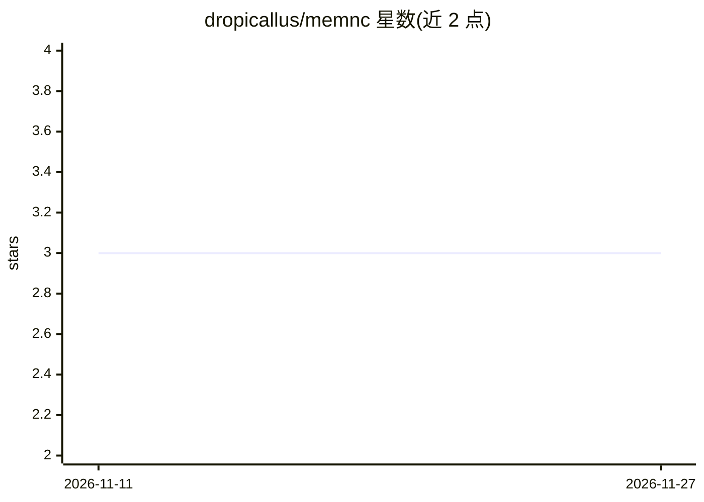

# dropicallus/memnc

⭐ 3 · Python · Apache-2.0 · 推送 2026-11-26 · [GitHub](https://github.com/dropicallus/memnc) · 个人维护

**自托管多节点多智能体协作框架，数据不出本地网络**

以 NATS 为唯一骨干的多智能体网格，用持久状态机驱动 planner→coder→critic 流水线跨 worker 节点运行；每个 worker 运行本地 MCP 工具服务器（文件系统+shell），并连接本地推理端点。任务采用 worker 驱动的 CAS 角色门控认领，orchestrator 中途被杀也不中断流水线；通过 VRAM/GPU/磁盘模型清单做资源感知路由，提供 Telegram 观察者与 Web 控制台，状态记录于持久账本（meshctl ledger）。部署以 docker compose 为主，本地开发需 Python 3.11+ 与 NATS。

## 筛选速览

| 维度 | 判定 | 备注 |
|---|---|---|
| AI 角色 | `ai-ecosystem` | LLM/agent 周边工具 |
| 许可风险 | `permissive` | Apache-2.0 |
| 部署形态 | `self-host` | docker 或自建部署 |
| 模型依赖 | local-ok | 支持本地模型 |
| 硬件要求 | — | 无带数字的原话,不猜 |
| 安装摩擦 | `low` | 无编译、无系统依赖或容器化 |
| 成熟度 | — | 结构信号不足 |

## 能力要点

- worker 驱动的 CAS 认领与角色门控交接，orchestrator 可中途终止
- 资源感知认领门控：按节点 VRAM/GPU/磁盘模型路由任务
- Telegram 观察者流式推送事件并接受门控控制命令
- 模型生命周期管理：拉取白名单、声誉、退役门控

## 适用场景

- 在自有 GPU 机器上搭建不依赖云的多智能体流水线
- 跨两台机器扩展 worker 容量并按算力分配任务
- 通过手机 Telegram 远程观察与干预任务执行

## 场景标签

`多智能体` · 领域:Agent 开发

## 证据(README 行号)

> L8: **A multi-agent mesh that runs entirely on your own hardware.**
> L9: NATS is the only backbone. A durable state machine drives `planner → coder → critic`
> L11: and talks to its own local inference endpoint (Ollama or any OpenAI-compatible API).

## 星数曲线

2026-11-11 3 → 2026-11-27 3（+0）

---
*卡片 v1 · prompt 1.4 · 生成 2026-11-22 · 置信度 high · 依据 README sha `37e26490cdcf` · [字段定义](../../DATASET.md)*
