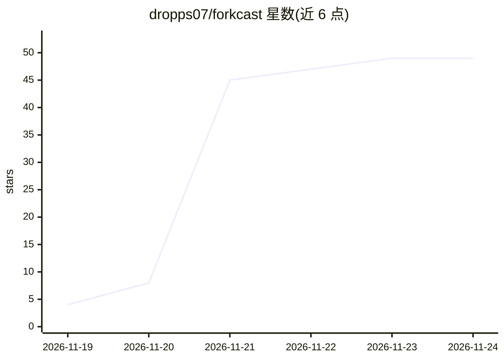

# dropps07/forkcast

⭐ 57 · TypeScript · MIT · 推送 2026-11-20 · [GitHub](https://github.com/dropps07/forkcast) · [官网](https://forkcast-frontend.onrender.com) · 个人维护

**面向个人用户的多天个性化膳食计划与食谱清单应用**

Web 应用，根据用户的饮食、预算与烹饪时间生成多天膳食计划，每餐链接到真实烹饪网站上的完整食谱；支持食品储藏追踪，并可将计划转换为带 Blinkit/BigBasket/Instamart 一键搜索链接的购物清单。AI 链以 Gemini 为主、Groq 兜底，SSE 流式输出，模型响应经 Zod 校验，食谱图片走 SSRF 安全代理。提供 Demo Mode，无 AI key 也能使用。

## 筛选速览

| 维度 | 判定 | 备注 |
|---|---|---|
| AI 角色 | `ai-native` | 本体是模型或模型工具 |
| 许可风险 | `permissive` | MIT |
| 部署形态 | `library` | 以包/库形式分发 |
| 模型依赖 | locked-api |  |
| 硬件要求 | — | 无带数字的原话,不猜 |
| 安装摩擦 | `low` | 无编译、无系统依赖或容器化 |
| 成熟度 | — | 结构信号不足 |

## 能力要点

- 两种生成模式：AI 生成与基于 Tavily 的实时网页搜索
- Gemini 主模型自动回退到 Groq 备用模型
- 储藏室追踪：规划时绕开已有食材
- 前后端各含测试（Vitest，52 项）

## 适用场景

- 按饮食偏好和预算生成一周的膳食计划
- 根据家里已有食材生成避开它们的菜单
- 把膳食计划变成购物清单并在印度电商平台搜索

## 场景标签

 · 领域:生活服务/餐饮工具

## 证据(README 行号)

> L4: > Generate a personalised multi-day meal plan, browse full recipes from real cooking sites, track what's in your pan
> L12: - **Personalised meal plans** — multi-day plans generated for your diet, cuisine, budget and cooking time, streamed
> L33: |AI|Google Gemini (`gemini-3.5-flash-lite`), Groq (`openai/gpt-oss-20b`), Tavily web search|

## 星数曲线

2026-11-19 4 → 2026-11-24 49（+45）

---
*卡片 v1 · prompt 1.4 · 生成 2026-11-20 · 置信度 high · 依据 README sha `4af4036e025b` · [字段定义](../../DATASET.md)*
