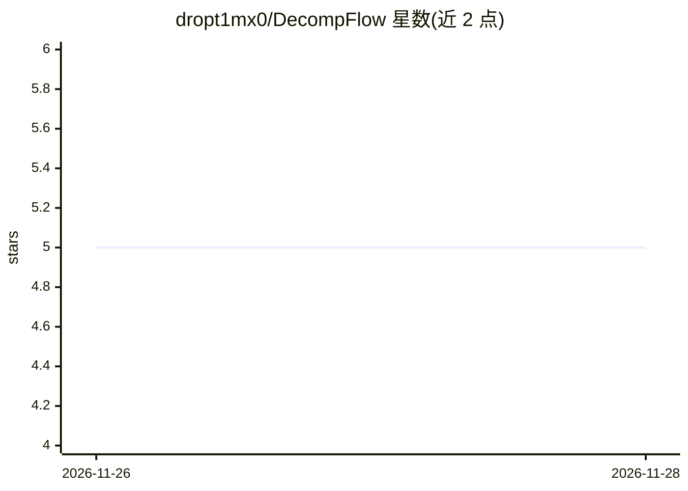

# dropt1mx0/DecompFlow

⭐ 5 · TypeScript · MIT · 推送 2026-11-24 · [GitHub](https://github.com/dropt1mx0/DecompFlow) · [官网](https://dropt1mx0.github.io/DecompFlow/) · 个人维护 · 中文 README

**给逆向工程师的多模型 AI 辅助二进制反编译分析工作台**

开源跨平台的 AI 逆向工程工作室，结合 LangGraph 多 agent 编排与 DeepSeek 系列模型（含 Ollama/LM Studio 离线路径）以及 Ghidra、Capa、Radare2 等分析工具，对原生二进制、Electron/ASAR 包、Web 应用和源码仓库执行自动化分析、功能重建与安全审计；每项发现附带证据链（路径、地址、置信度），并提供 CLI 与 Electron 桌面双界面，Mermaid 图与 React Flow 节点图可视化结果。安装需 Node.js ≥20 与 npm 构建。

## 筛选速览

| 维度 | 判定 | 备注 |
|---|---|---|
| AI 角色 | `ai-native` | 本体是模型或模型工具 |
| 许可风险 | `permissive` | MIT |
| 部署形态 | `desktop` | 安装包/桌面程序 |
| 模型依赖 | local-ok | 支持本地模型 |
| 硬件要求 | — | 无带数字的原话,不猜 |
| 安装摩擦 | `low` | 无编译、无系统依赖或容器化 |
| 成熟度 | — | 结构信号不足 |

## 能力要点

- 多目标自动识别：原生二进制/ASAR/Web/源码仓库分流处理
- LangGraph 多 agent 编排，支持 DeepSeek-R1/V3 及 100% 离线 Ollama/LM Studio
- CLI（dfw/decomp）与桌面 GUI 双界面，结果带可验证证据链
- 技能以 skills/*.md Markdown 文件模块化组织

## 适用场景

- 对无源码的 ELF/EXE/DLL 做函数反编译与控制流重建
- 审计 Electron 应用的 IPC 通道与 preload 桥接
- 从 Web 应用提取隐藏的 REST/WebSocket 端点
- 为陌生代码库生成架构图与上手文档

## 场景标签

`网络安全` · 领域:学习与行业

## 证据(README 行号)

> L27: **DecompFlow** is an open-source, cross-platform **AI reverse engineering studio** and powerful **DecompFlow CLI** 
> L29: Instead of locking you into a fragile custom loop or a terminal-only chat, DecompFlow combines deterministic **Lang
> L34:  - 🧬 **Native Binaries (`.exe`, `.elf`, `.dll`, `.so`, `.dylib`, `.apk`):** Decompiles functions, traces cross-refe

## 星数曲线

2026-11-26 5 → 2026-11-28 5（+0）

---
*卡片 v1 · prompt 1.4 · 生成 2026-11-26 · 置信度 high · 依据 README sha `aa4209a0b66f` · [字段定义](../../DATASET.md)*
