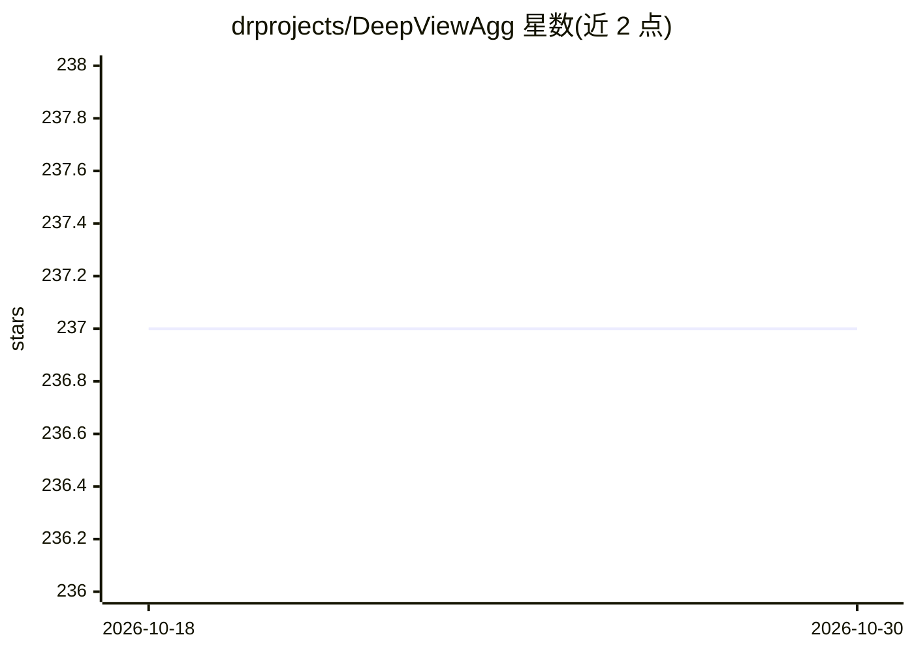

# drprojects/DeepViewAgg

⭐ 237 · Python · NOASSERTION · 推送 2026-02-11 · [GitHub](https://github.com/drprojects/DeepViewAgg) · 组织维护

**CVPR'22 论文官方实现：多视角聚合的大规模 3D 语义分割**

Learning Multi-View Aggregation In the Wild for Large-Scale 3D Semantic Segmentation（CVPR'22 Best Paper Finalist）的官方 PyTorch 实现。方法端到端学习 2D+3D 特征，利用 3D 点的观测条件做注意力式多视角聚合，仅需原始点云、图像与位姿，无需点云着色、网格化、深度相机或 2D 标注。基于修改版 Torch-Points3D 框架构建，提供 S3DIS/KITTI-360/ScanNet 的预训练权重、notebook 与训练脚本；安装需 Anaconda3、CUDA≥10.1、gcc≥7 及 sudo 权限编译 MinkowskiEngine/TorchSparse。

## 筛选速览

| 维度 | 判定 | 备注 |
|---|---|---|
| AI 角色 | `ai-native` | 本体是模型或模型工具 |
| 许可风险 | `none` | NOASSERTION |
| 部署形态 | `None` |  |
| 模型依赖 | — | README 未给出锁定关系 |
| 硬件要求 | — | 无带数字的原话,不猜 |
| 安装摩擦 | `high` | 编译与系统依赖俱全 |
| 成熟度 | — | 结构信号不足 |

## 能力要点

- 基于观测条件的注意力式多视角特征聚合（2D+3D 端到端）
- 提供 S3DIS/KITTI-360/ScanNet 预训练权重与复现脚本
- 基于 Torch-Points3D 修改版，多模态数据/模型/可视化模块化组织
- notebook 支持从 checkpoint 推理与交互式 HTML 可视化

## 适用场景

- 在大规模点云数据集上复现论文的 3D 语义分割结果
- 做多模态（图像+点云）分割研究的代码基础
- 交互式查看多模态数据与点-图像映射

## 场景标签

`多模态` · 领域:感知与多模态

## 证据(README 行号)

> L33: We propose to exploit the synergy between **images** 🖼️ and **3D point clouds**
> L43: |🤖 Learns **2D+3D features** end-to-end|

## 星数曲线

2026-10-18 237 → 2026-10-30 237（+0）

---
*卡片 v1 · prompt 1.4 · 生成 2026-10-22 · 置信度 high · 依据 README sha `d22bc93cb41a` · [字段定义](../../DATASET.md)*
