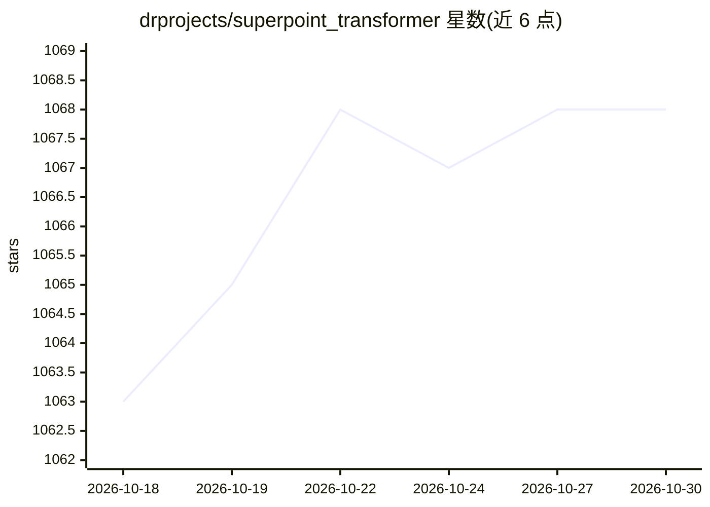

# drprojects/superpoint_transformer

⭐ 1,068 · Python · MIT · 推送 2026-10-28 · [GitHub](https://github.com/drprojects/superpoint_transformer) · 组织维护

**大规模 3D 点云语义/全景分割的 PyTorch 官方实现（三篇论文）**

包含三篇论文的官方 PyTorch 实现：Superpoint Transformer（ICCV'23，超点 transformer 语义分割）、SuperCluster（3DV'24 Oral，将全景分割表述为超点图聚类）、EZ-SP（ICRA'26，GPU 可学习划分替代 CPU cut-pursuit）。面向 3D 视觉研究者与开发者，基于 PyTorch Lightning + Hydra，提供 install.sh 一键 conda 安装、预训练权重、训练/评估 CLI 与教程；在 S3DIS/KITTI-360/DALES/ScanNet 等数据集上运行。EZ-SP 版本代码不向后兼容，提供了迁移脚本说明。

## 筛选速览

| 维度 | 判定 | 备注 |
|---|---|---|
| AI 角色 | `ai-native` | 本体是模型或模型工具 |
| 许可风险 | `permissive` | MIT |
| 部署形态 | `None` |  |
| 模型依赖 | — | README 未给出锁定关系 |
| 硬件要求 | — | 无带数字的原话,不猜 |
| 安装摩擦 | `medium` | 含编译或系统依赖之一 |
| 成熟度 | — | 结构信号不足 |

## 能力要点

- 超点分层划分 + 自注意力机制的大场景 3D 语义分割（SPT）
- 全景分割表述为可扩展超点图聚类（SuperCluster）
- EZ-SP 用可学习 GPU 划分替代 CPU cut-pursuit，端到端比 SPT 快 5.3 倍
- 提供 S3DIS/KITTI-360/DALES/ScanNet 预训练权重与训练/评估命令

## 适用场景

- 在大规模点云数据集上训练/评估 3D 语义或全景分割模型
- 复现论文结果或基于预训练权重做推理
- 用轻量模型（<1M 参数）在单 GPU 上处理超大规模 3D 场景

## 场景标签

`目标检测` · 领域:感知与多模态

## 证据(README 行号)

> L37: **Superpoint Transformer (SPT)** is a superpoint-based transformer 🤖 architecture that efficiently ⚡
> L59: **SuperCluster** is a superpoint-based architecture for **panoptic segmentation** of (very) large 3D scenes 🐘 based
> L90: with a **fast and learnable GPU-based partitioning**.

## 星数曲线

2026-10-18 1,063 → 2026-10-30 1,068（+5）

---
*卡片 v1 · prompt 1.4 · 生成 2026-10-21 · 置信度 high · 依据 README sha `64053ea676a8` · [字段定义](../../DATASET.md)*
