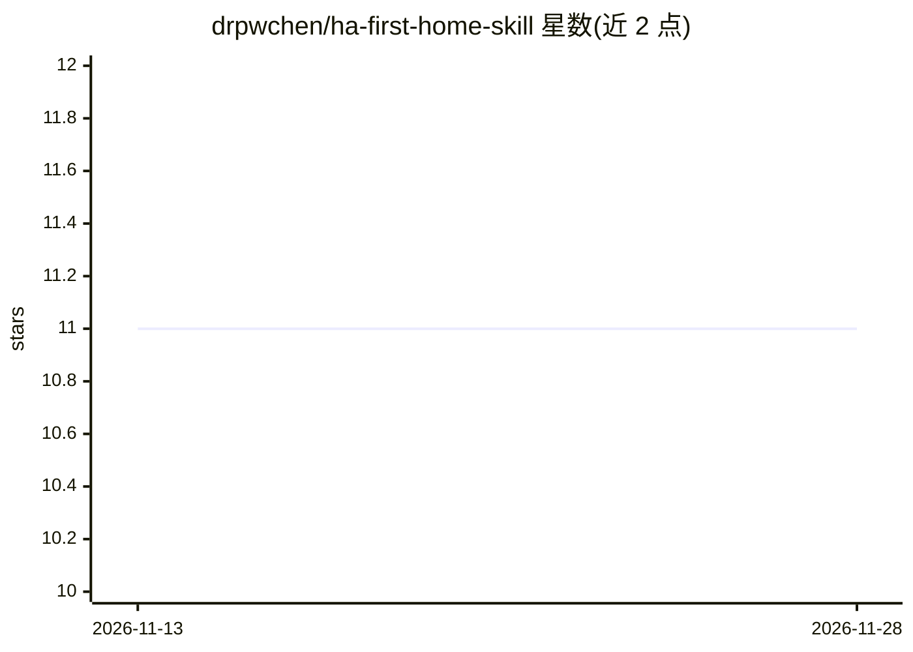

# drpwchen/ha-first-home-skill

⭐ 11 · Python · NOASSERTION · 推送 2026-11-13 · [GitHub](https://github.com/drpwchen/ha-first-home-skill) · [官网](https://drpwchen.com/posts/smart-home-2026-rebuild/) · 个人维护 · 中文 README

**给 HA 新手的繁中 Agent Skill：访谈后产出必买/可等/别买清单**

一个纯文本的 Agent Skill 文件包，供 Claude Code、Codex CLI 等支持 Agent Skills 标准的 agent 载入。载入后 agent 按预设访谈流程询问用户生活需求、住家情况、预算与隐私底线，再输出三格购物清单（必买/可等/别买）与购买前查证事项。刻意不包含设备型号与价格，要求 agent 当下联网查证并附链接。不写自动化 YAML、不修改 HA 配置，定位为安装 HA 之前的规划阶段使用。判断原则来自作者四年 HA 运行纪录与社群整理。

## 筛选速览

| 维度 | 判定 | 备注 |
|---|---|---|
| AI 角色 | `ai-knowledge` | 知识聚合/清单类 |
| 许可风险 | `none` | NOASSERTION |
| 部署形态 | `None` |  |
| 模型依赖 | — | README 未给出锁定关系 |
| 硬件要求 | — | 无带数字的原话,不猜 |
| 安装摩擦 | `low` | 无编译、无系统依赖或容器化 |
| 成熟度 | — | 结构信号不足 |

## 能力要点

- 访谈式流程：生活问题、住家、租/自有、预算、隐私底线等问卷
- 三格表输出：必买/可等/别买，每项需回答盯什么状态、断网剩什么、谁发现故障
- 台湾在地查核要点：110V、NCC、商品安全标章、陆版米家、繁中语音
- 不放设备型号与价格，要求 agent 当下查证并附链接与日期

## 适用场景

- 我完全没经验，想在买第一批智能家居设备前做规划
- 我想知道哪些设备该买、哪些可以先等、哪些别买
- 在台湾选购设备时查核电压、认证与本地兼容性

## 场景标签

 · 领域:智能家居/规划指南

## 证据(README 行号)

> L5: 一個 Agent Skill，讓 Claude Code、Codex 這類 AI agent
> L7: 能不能動線路、斷網要剩什麼，再給你一張**第一期購物清單三格表（必買／可等／別買）**和**買之前要查的事**。
> L22: 判斷原則出自作者家裡一套 HA 四年多的長期運作紀錄（243 條自動化），重點是新手「不知道要問的問題」：

## 星数曲线

2026-11-13 11 → 2026-11-28 11（+0）

---
*卡片 v1 · prompt 1.4 · 生成 2026-11-18 · 置信度 mid · 依据 README sha `ded9e167c2ea` · [字段定义](../../DATASET.md)*
