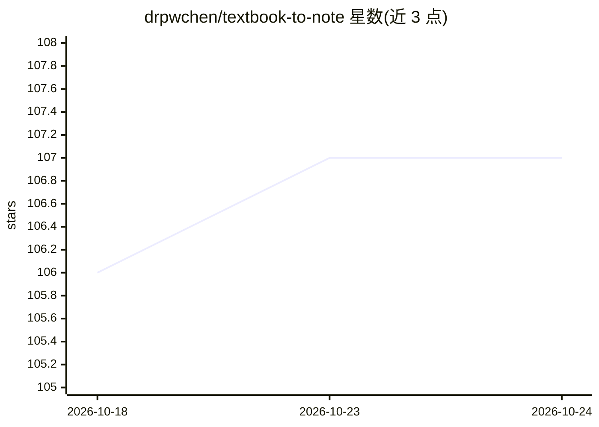

# drpwchen/textbook-to-note

⭐ 107 · Python · MIT · 推送 2026-08-26 · [GitHub](https://github.com/drpwchen/textbook-to-note) · [官网](https://drpwchen.com/posts/textbook-to-note/) · 个人维护 · 中文 README

**把 PDF 教材转成可检索知识库并生成带引用笔记的本地流水线**

面向个人学习（作者为医学背景）的本地优先流水线：将 PDF/EPUB 教材转换为带页码标记的 markdown，包含双栏阅读顺序重建、表抽取 QC 门控、跨页表合并与伪表剔除，扫描/坏字体书走 Surya→PaddleOCR-VL→本地视觉模型→前沿模型的 OCR 阶梯；重型处理零 LLM token，仅在笔记综合阶段调用模型，每条声明可溯源到书+章节，AI 推断内容会被标记。按 A/B/C 三档递进配置，A 档仅转换（无 GPU、无索引），C 档配合同伴仓库 vault-search 做语义检索；本仓库不含索引器。

## 筛选速览

| 维度 | 判定 | 备注 |
|---|---|---|
| AI 角色 | `ai-native` | 本体是模型或模型工具 |
| 许可风险 | `permissive` | MIT |
| 部署形态 | `library` | 以包/库形式分发 |
| 模型依赖 | — | README 未给出锁定关系 |
| 硬件要求 | — | 无带数字的原话,不猜 |
| 安装摩擦 | `low` | 无编译、无系统依赖或容器化 |
| 成熟度 | — | 结构信号不足 |

## 能力要点

- PyMuPDF 抽取约 130ms/页，静默失败检测后仅路由问题页到 OCR 阶梯
- 确定性 QC 门控：表结构校验、内容损失率横幅、错装订高风险表人工复核队列
- 每条声明引用书+章节，AI 推断的新增内容显式标记
- 三档递进配置（转换/笔记工作流/语义检索），互不重做

## 适用场景

- 把手头的专业教材 PDF 批量转成可 grep 的 markdown 库
- 让 AI 基于自己教材库生成结构化、逐条引用的学习笔记
- 跨书按语义检索'这个概念在哪本书里讲过'

## 场景标签

`知识库管理` `RAG` `OCR` `文档解析` · 领域:知识与检索

## 证据(README 行号)

> L5: Turn your own PDF textbooks into an AI-searchable knowledge base and structured, fully-cited notes — figures include
> L11: I've loved taking notes since med school, and over the years I've built up thousands of them — but I can no longer 
> L26: |**B · A + the note workflow**|An AI writes structured, per-claim-cited notes from that corpus, with figures extrac

## 星数曲线

2026-10-18 106 → 2026-10-24 107（+1）

---
*卡片 v1 · prompt 1.4 · 生成 2026-10-23 · 置信度 high · 依据 README sha `834b5c9c50ed` · [字段定义](../../DATASET.md)*
