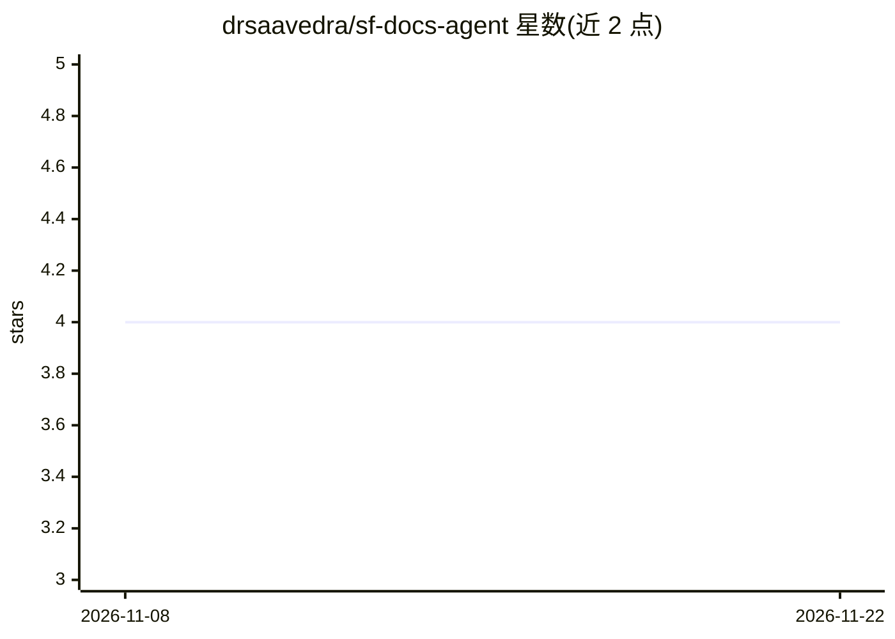

# drsaavedra/sf-docs-agent

⭐ 4 · JavaScript · MIT · 推送 2026-11-13 · [GitHub](https://github.com/drsaavedra/sf-docs-agent) · [官网](https://www.npmjs.com/package/sf-docs-agent) · 个人维护

**从官方 Salesforce 文档检索并核对引用的 Claude Code 子代理**

一个安装到 Claude Code 的子代理（sf-docs），在代理自身上下文中读取 Salesforce 官方文档站（developer/architect/help/admin/SLDS），由模型挑选行号、脚本逐字复制引文，并经 hook 用 grep 对照缓存页面核验每条引文与来源 URL。通过 llms.txt/站点地图或用户提供的链接定位页面，优先读 .md 副本，无副本时用无头浏览器渲染；页面缓存 24 小时。宣称比 Salesforce 官方 docs skill 少向会话注入 83% token。需要 Node 22+ 与 Claude Code，npm 安装，无 API key、无 MCP 服务器。

## 筛选速览

| 维度 | 判定 | 备注 |
|---|---|---|
| AI 角色 | `ai-native` | 本体是模型或模型工具 |
| 许可风险 | `permissive` | MIT |
| 部署形态 | `library` | 以包/库形式分发 |
| 模型依赖 | locked-api |  |
| 硬件要求 | — | 无带数字的原话,不猜 |
| 安装摩擦 | `low` | 无编译、无系统依赖或容器化 |
| 成熟度 | — | 结构信号不足 |

## 能力要点

- 模型选行、脚本逐字复制，hook 用 grep 对缓存页核验每条引文与 URL
- 通过 llms.txt 索引/站点地图定位页面，.md 副本缺失时用无头浏览器渲染
- 页面按 URL 缓存 24 小时，多会话共享磁盘缓存
- 报告明确列出未读取的页面与链接（gap）

## 适用场景

- 在 Claude Code 会话中查询 Apex/LWC 管制限制等官方文档细节
- 需要逐字引用并附官方 URL 的技术文档回答
- 控制上下文 token 消耗的文档查阅工作流

## 场景标签

`编码 Agent` `文档问答` · 领域:编码与开发

## 证据(README 行号)

> L3: **Read the docs, keep your context.** A Claude Code agent that reads the official Salesforce docs for you and return
> L17: The agent reads the pages in its own context. The model picks the lines and a script copies them word for word from
> L26: npx sf-docs-agent

## 星数曲线

2026-11-08 4 → 2026-11-22 4（+0）

---
*卡片 v1 · prompt 1.4 · 生成 2026-11-21 · 置信度 high · 依据 README sha `e79702aad762` · [字段定义](../../DATASET.md)*
