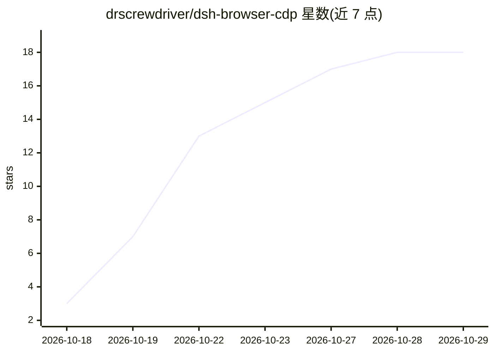

# drscrewdriver/dsh-browser-cdp

⭐ 18 · TypeScript · MIT · 推送 2026-10-28 · [GitHub](https://github.com/drscrewdriver/dsh-browser-cdp) · [官网](https://www.npmjs.com/package/dsh-browser-cdp) · 个人维护 · 中文 README

**让 Agent 通过 CDP 接入真实 Chrome 的 DSH 插件，附实时观察窗**

DeepSeek Harness（DSH）的浏览器插件（原 dsh-ego-browser）：内置 ego 兼容 Chromium 运行时，以 34 个结构化 bcdp_* 工具驱动浏览器，供 AI Agent 操作网页。配 SSE 实时观察窗（CDP JPEG / FFmpeg H.264 双后端），支持监控窗鼠标直接接管、点选元素引用进对话输入框、按域名导入 Chrome/Edge/Brave 登录 cookie、下载捕获与人机验证检测。兼容 DSH 0.1.7-rc.1~0.2.1-rc.4，可选 dsh-better-sidebar 侧边栏 Tab 或回退浮动观察球，支持 Lightpanda 无头引擎（能力自动降级）。

## 筛选速览

| 维度 | 判定 | 备注 |
|---|---|---|
| AI 角色 | `ai-ecosystem` | LLM/agent 周边工具 |
| 许可风险 | `permissive` | MIT |
| 部署形态 | `self-host` | docker 或自建部署 |
| 模型依赖 | locked-api |  |
| 硬件要求 | — | 无带数字的原话,不猜 |
| 安装摩擦 | `low` | 无编译、无系统依赖或容器化 |
| 成熟度 | `idea` | |

## 能力要点

- 34 个 bcdp_* 结构化工具驱动浏览器，任务空间/导航/页面读取/登录导入等
- SSE 实时观察窗：看直播、鼠标接管、点选元素引用进输入框
- 登录态按域名导入（兼容 Chrome 127+ App-Bound Encryption），跨重启持久化
- 内置 ego 兼容运行时，root/Docker/无显示器免额外配置，支持 Lightpanda 可选引擎

## 适用场景

- 让 agent 在真实浏览器中登录、抓取文献与填表，人在观察窗随时接管
- agent 遇到验证码时人工点选后交还继续执行
- 通过点选页面元素向 agent 精确指认操作目标

## 场景标签

`浏览器自动化` · 领域:效率与自动化

## 证据(README 行号)

> L35: 一款 **CDP 浏览器代理**：内置 **ego 兼容运行时**（供 AI Agent 用的 Chromium，来源与许可逐文件见 THIRD_PARTY_NOTICES.md）接入 DeepSeek Harness，以 **3
> L104: dsh plugin --profile web add github:drscrewdriver/dsh-browser-cdp

## 星数曲线

2026-10-18 3 → 2026-10-29 18（+15）

---
*卡片 v1 · prompt 1.4 · 生成 2026-10-29 · 置信度 mid · 依据 README sha `2d953dc9b85e` · [字段定义](../../DATASET.md)*
