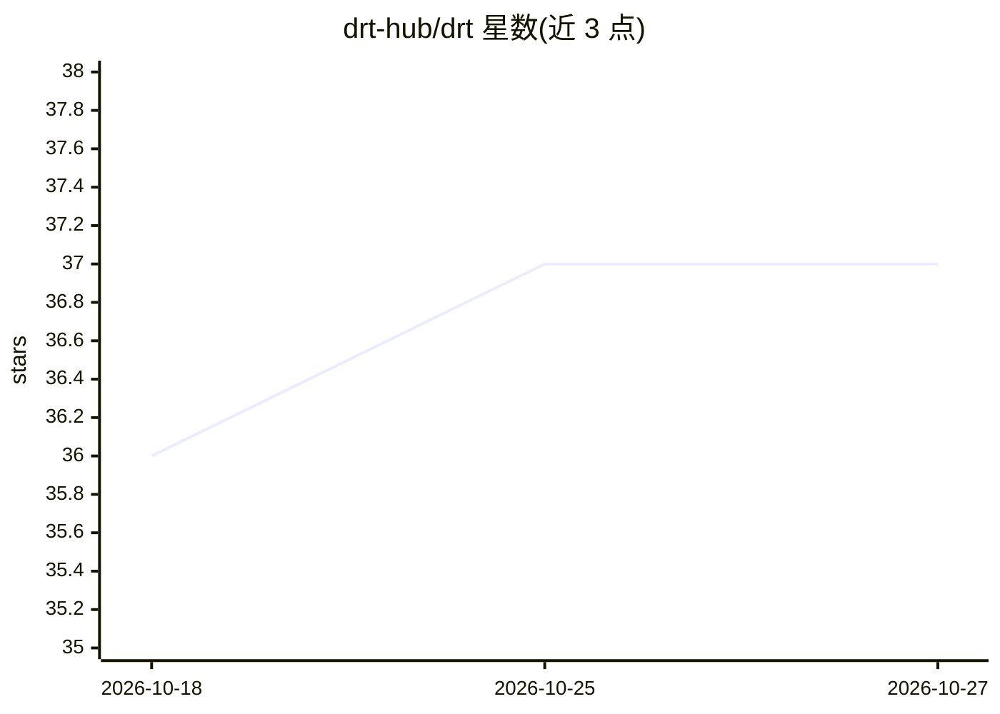

# drt-hub/drt

⭐ 37 · Python · Apache-2.0 · 推送 2026-10-26 · [GitHub](https://github.com/drt-hub/drt) · [官网](https://drt-hub.github.io/drt-web/) · 组织维护

**面向开发者的反向 ETL 工具：用 YAML 把数仓数据同步回业务系统**

命令行反向 ETL 工具：以 Git 仓库中版本化的 YAML 声明同步任务，将 BigQuery、Snowflake、DuckDB、PostgreSQL 等 12 种数据源的数据写入 Slack、HubSpot、Salesforce、S3 等 36 种目的地，数据直接从仓库到目的地。提供 plan/apply 审查机制（只读变更集、delete 防护、fill_empty 填充策略）、CI 集成（GitHub Actions/Dagster/Airflow）、Mermaid DAG 文档生成，以及内置 MCP server 和 Claude Code 技能让 AI 工具代写与执行同步。Apache 2.0 开源，pip 安装，自托管。

## 筛选速览

| 维度 | 判定 | 备注 |
|---|---|---|
| AI 角色 | `ai-enhanced` | 去掉 AI 部分产品仍成立 |
| 许可风险 | `permissive` | Apache-2.0 |
| 部署形态 | `library` | 以包/库形式分发 |
| 模型依赖 | locked-api |  |
| 硬件要求 | — | 无带数字的原话,不猜 |
| 安装摩擦 | `low` | 无编译、无系统依赖或容器化 |
| 成熟度 | — | 结构信号不足 |

## 能力要点

- 12 种源 + 36 种目的地的反向 ETL，YAML 声明式配置
- drt plan/apply 审查机制：只读变更集、max_delete_pct 删除防护、fill_empty 填充策略
- 内置 MCP server 暴露 17 个工具，可由 Claude/Cursor 等 AI 客户端调用
- 官方 Claude Code 技能（斜杠命令）生成/调试/迁移同步配置

## 适用场景

- 把 dbt 加工后的数仓模型同步回 CRM、Slack、广告平台等业务工具
- 在 CI 流水线中以 plan 评审 + merge 后 apply 的方式执行同步
- 让 Claude 等 AI 助手通过 MCP 生成和运行同步配置

## 场景标签

 · 领域:数据工程/反向 ETL

## 证据(README 行号)

> L7: dlt loads data in, dbt transforms it, and **drt** activates it back out — reverse ETL from your warehouse to the too
> L40: **LLM-native.** A built-in MCP server and Claude Code skills let AI tools author and run your syncs.

## 星数曲线

2026-10-18 36 → 2026-10-27 37（+1）

---
*卡片 v1 · prompt 1.4 · 生成 2026-10-25 · 置信度 high · 依据 README sha `99099df09386` · [字段定义](../../DATASET.md)*
