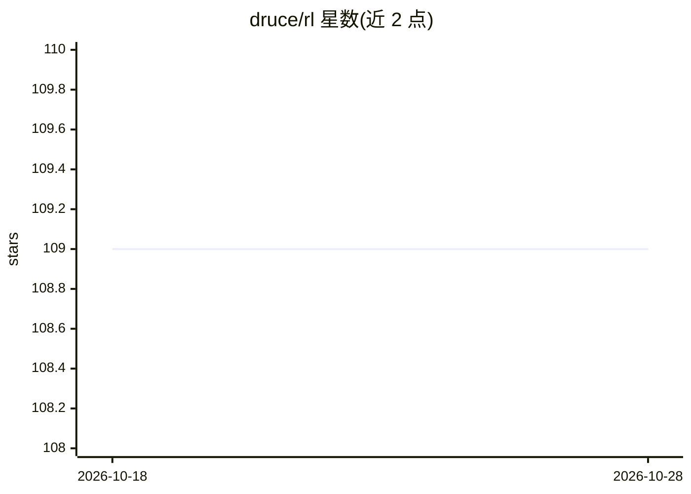

# druce/rl

⭐ 109 · Jupyter Notebook · 推送 2026-08-19 · [GitHub](https://github.com/druce/rl) · [官网](https://alphaarchitect.com/2020/02/26/reinforcement-learning-for-trading/) · 个人维护

**强化学习交易教学笔记本集：从DQN到RL交易算法**

配套 Alpha Architect 博客文章的代码与 Jupyter 笔记本集合：用表格法RL玩井字棋、用 Keras 从零实现 DQN/REINFORCE 等算法跑 CartPole/LunarLander、Ray/RLlib 调用、以及在仿真市场数据上做强化学习交易（灵感来自 Gordon Ritter 论文）。安装依赖 Anaconda/conda 环境（TensorFlow 或 tensorflow-gpu）加 requirements.txt，部分笔记本可在 Google Colab 运行。

## 筛选速览

| 维度 | 判定 | 备注 |
|---|---|---|
| AI 角色 | `ai-knowledge` | 知识聚合/清单类 |
| 许可风险 | `none` | — |
| 部署形态 | `library` | 以包/库形式分发 |
| 模型依赖 | — | README 未给出锁定关系 |
| 硬件要求 | — | 无带数字的原话,不猜 |
| 安装摩擦 | `medium` | 含编译或系统依赖之一 |
| 成熟度 | — | 结构信号不足 |

## 能力要点

- Keras 从零实现 DQN 与策略梯度算法
- Ray/RLlib 笔记本调用 Berkeley RL 框架
- Trading_with_RL 笔记本在仿真数据上实现RL交易
- 提供只运行已保存模型不训练的笔记本

## 适用场景

- 学习深度强化学习算法的动手实现
- 了解强化学习应用于交易的示例代码
- 在 Colab 中复现论文式RL实验

## 场景标签

`金融量化` `强化学习` `教程课程` · 领域:学习与行业

## 证据(README 行号)

> L1: Notebooks and code for Alpha Architect post on reinforcement learning.
> L10: - Trading_with_RL.ipynb - Algos to trade fake market data, inspired by Gordon Ritter paper Machine Learning for Tra

## 星数曲线

2026-10-18 109 → 2026-10-28 109（+0）

---
*卡片 v1 · prompt 1.4 · 生成 2026-10-23 · 置信度 high · 依据 README sha `338b1089ce3a` · [字段定义](../../DATASET.md)*
