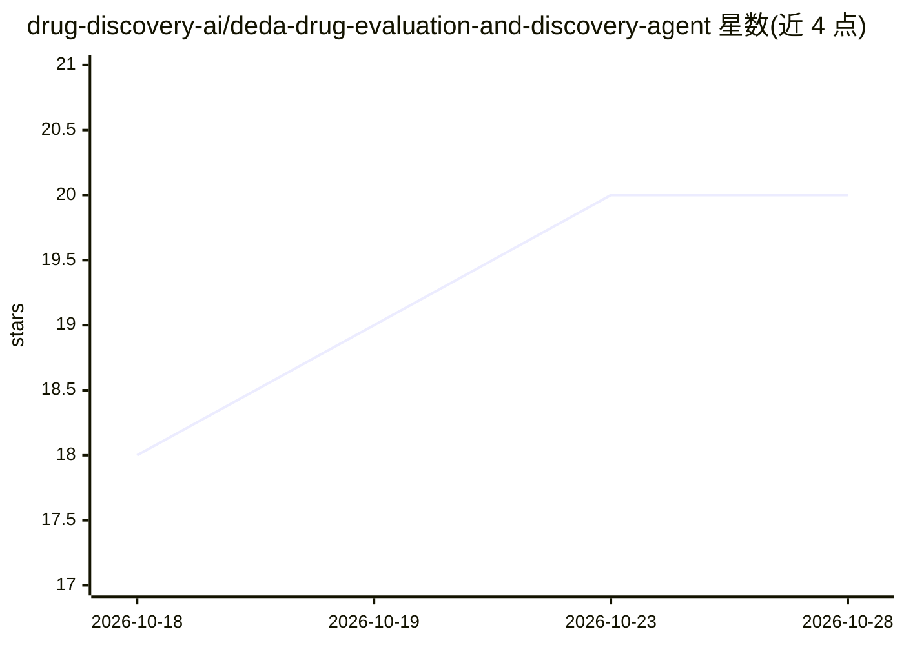

# drug-discovery-ai/deda-drug-evaluation-and-discovery-agent

⭐ 20 · Python · 推送 2026-02-22 · [GitHub](https://github.com/drug-discovery-ai/deda-drug-evaluation-and-discovery-agent) · 组织维护

**面向生物医学研究者的药物发现 AI 对话代理工具**

DEDA 是面向生物信息学研究者的 AI agent 工具，通过英文指令执行药物发现相关任务：连接 UniProt、AlphaFold、OpenTargets 等数据源查询蛋白信息、结合口袋等，以真实数据源约束回答以减少幻觉。提供四种使用方式：MCP 服务器（可接入 Claude Desktop 等客户端）、CLI 聊天、Electron 桌面应用（可构建 Windows/macOS/Linux 安装包）与 Docker 运行；需要 OpenAI API key。README 声明该工具不做发明，最终判断须由领域专家做出。

## 筛选速览

| 维度 | 判定 | 备注 |
|---|---|---|
| AI 角色 | `ai-native` | 本体是模型或模型工具 |
| 许可风险 | `none` | — |
| 部署形态 | `desktop` | 安装包/桌面程序 |
| 模型依赖 | — | README 未给出锁定关系 |
| 硬件要求 | — | 无带数字的原话,不猜 |
| 安装摩擦 | `low` | 无编译、无系统依赖或容器化 |
| 成熟度 | — | 结构信号不足 |

## 能力要点

- 通过英文自然语言指令执行生物信息学工作流
- 连接 UniProt / AlphaFold / OpenTargets 等数据源以约束回答
- 提供 MCP 服务器、CLI、Electron 桌面端与 Docker 四种运行方式
- 可构建 Windows(.exe)/macOS(.dmg)/Linux(.AppImage) 原生安装包

## 适用场景

- 用英文对话查询 SARS-CoV-2 等蛋白的结合口袋与结构性质
- 生物医学研究人员快速测试药物发现想法而不写代码
- 通过 MCP 客户端（如 Claude Desktop）集成该 agent

## 场景标签

`聊天机器人` `科研工具` · 领域:对话与助手

## 证据(README 行号)

> L9: DEDA - think of ChatGPT for bioinformatics researchers.
> L13: DEDA focuses on integrating workflows, helping researchers explore drug discovery, analyze proteins, and quickly te
> L23: The AI connects to trusted sources like **UniProt**, **AlphaFold**, **OpenTargets** and others. This grounds its an

## 星数曲线

2026-10-18 18 → 2026-10-28 20（+2）

---
*卡片 v1 · prompt 1.4 · 生成 2026-10-28 · 置信度 high · 依据 README sha `d017bb106a3c` · [字段定义](../../DATASET.md)*
